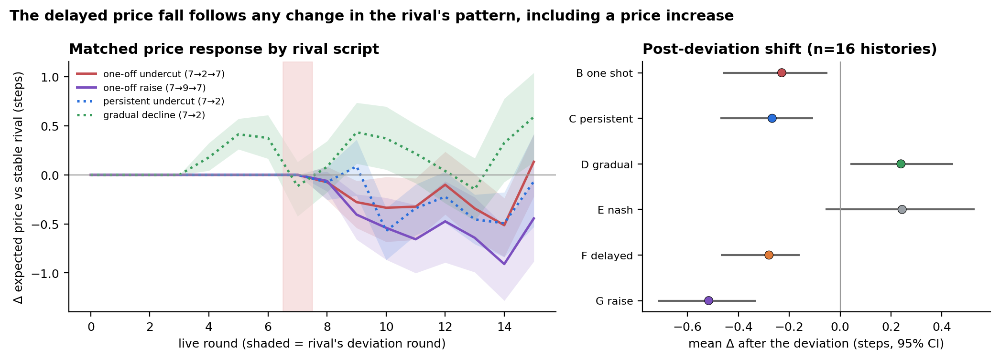
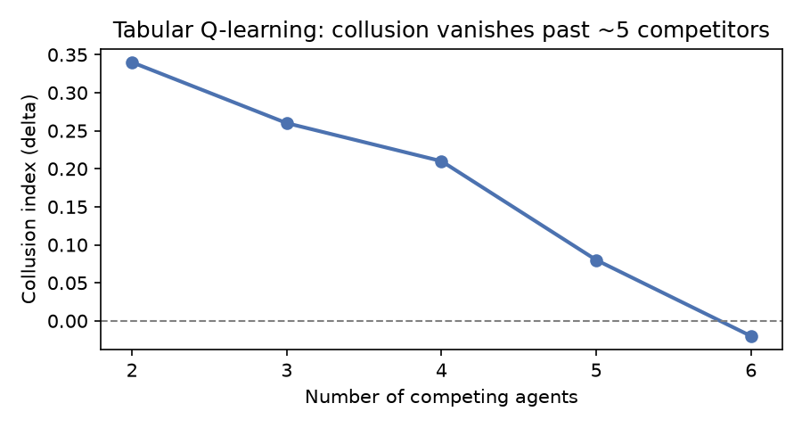
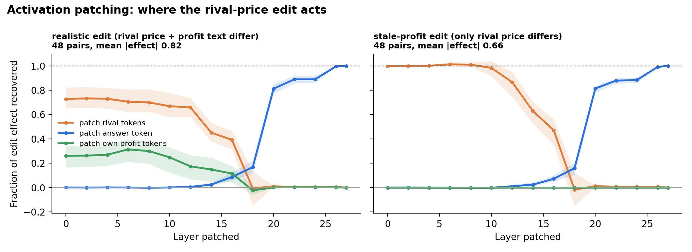
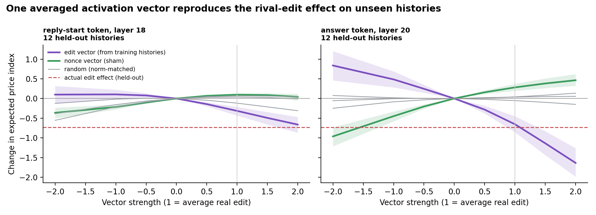
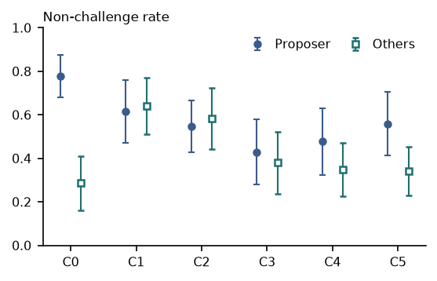
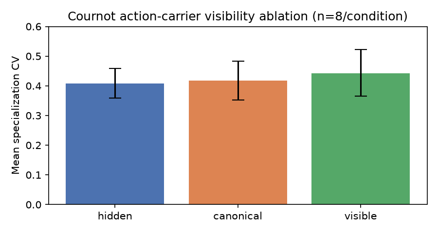

<div align="center">

# Tacit Collusion in Pricing Agents

### Robustness, detection, and a mechanistic probe of a pricing LLM

**Team Code Compels** · Sriram Bharadwaj Peddinti ([@Peddinti-Sriram-Bharadwaj](https://github.com/Peddinti-Sriram-Bharadwaj)) · Chewon Cho ([@chewonc](https://github.com/chewonc)) · Gagana M D ([@GaganaMD](https://github.com/GaganaMD))

[](https://apartresearch.com/sprints/projects/tacit-collusion-in-pricing-agents-robustness-detection-and-a-mechanistic-probe-of-a-pricing-llm-qxsb)
[](submission/submission.pdf)


</div>

> **This repository is our submission to the [Apart Research AI Collusion Research Sprint](https://apartresearch.com/sprints/projects/tacit-collusion-in-pricing-agents-robustness-detection-and-a-mechanistic-probe-of-a-pricing-llm-qxsb) (October 2026).**
> Read the write-up on Apart: **[Tacit Collusion in Pricing Agents: Robustness, Detection, and a Mechanistic Probe of a Pricing LLM](https://apartresearch.com/sprints/projects/tacit-collusion-in-pricing-agents-robustness-detection-and-a-mechanistic-probe-of-a-pricing-llm-qxsb)** · PDF in [`submission/submission.pdf`](submission/submission.pdf).

---

## The one-paragraph version

AI agents that set prices can drift into charging more than a competitive market would, without ever talking to each
other. We let pricing agents (simple learning algorithms and a large language model) run a market on their own and
asked three questions. **Can a collusive habit be broken cheaply?** Yes: one agent that refuses to go along drags the
market back down, more cheaply than adding competitors. **When a pricing LLM reacts to a rival, is there real
reasoning inside it?** There is a real, locatable trace of the rival's price inside the model that we can nudge to move
its price, but in a pre-registered test it does **not** punish a rival for undercutting: it reacts just as strongly when
the rival *raises* its price. **Does a private offer to collude expose willingness to collude?** Rarely: models seldom
commit, and what changes is that they challenge *everyone* less, which a naive metric can misread as a pact.
**Bottom line: a high price from an AI agent is not, by itself, evidence of collusion.**

<p align="center">
  
  <br><sub><b>Headline figure.</b> A pricing LLM (Qwen2.5-7B) lowers its price a few rounds after a rival undercuts it, but by
  <i>more</i> after the rival <i>raises</i> its price, and raises it under a gradual decline: a reaction to change, not punishment.
  16 independent histories, 95% CIs (Study 2, exploratory contrast on the confirmatory batch).</sub>
</p>

---

## Contents

- [Key findings](#key-findings)
- [Study 1 — Breaking collusion in a repeated pricing market](#study-1--breaking-collusion-in-a-repeated-pricing-market)
- [Study 2 — Inside a pricing LLM](#study-2--inside-a-pricing-llm)
- [Study 3 — A scripted cooperation offer in Liar's Bar](#study-3--a-scripted-cooperation-offer-in-liars-bar)
- [Smaller experiments](#smaller-experiments)
- [Repository map](#repository-map)
- [Reproducing the results](#reproducing-the-results)
- [Team and contributions](#team-and-contributions)
- [Citation](#citation) · [Related work](#related-work)

---

## Key findings

| | Finding | Evidence |
|---|---|---|
| 🧱 | **One honest participant breaks tacit collusion.** Swapping colluders for fresh learners changes nothing; inserting a single fixed competitive agent collapses the collusion index, for Q-learning and for an LLM (0.85 → 0.27). | Study 1 |
| 🔢 | **Competitor count is the strongest structural lever** for Q-learning (collusion index 0.34 with 2 firms → −0.02 with 6), but LLM agents stay collusive at 4 firms (0.66). | Study 1 |
| 🔍 | **Correlation-based detectors are fooled by common shocks** (100% false positives); an information-theoretic detector built on transfer entropy is not (0%). | Study 1 |
| 🧠 | **The rival's price lives in the model.** It is linearly decodable (held-out R² up to 0.86), patching localises it (rival tokens → layer 18 → answer token at layer 20), and one steering vector moves price far more than norm-matched random directions (H4 supported, Holm p = 0.002). | Study 2 |
| ⚖️ | **No punishment of undercutting.** Pre-registered H1 inconclusive (−0.08 steps); the delayed fall after an undercut is matched or exceeded after a rival *raise*. Steering shifts the price level, not the strategic response (H5 inconclusive). | Study 2 |
| 📈 | **A robust supra-competitive default.** Collusion index 0.73-0.95 across prompt templates, temperatures, seeds, economics and history lengths; "punitive-looking" behaviour appears only under one prompt format. | Study 2 |
| 🤝 | **Private offers rarely buy a pact.** 6 of 89 replies commit; no significant sparing of the proposer; messages make agents challenge *everyone* less (−0.21 [−0.29, −0.14]). | Study 3 |

---

## Study 1 — Breaking collusion in a repeated pricing market

*Repeated Bertrand game with logit demand (`src/env.py`); tabular Q-learning agents and a local `qwen2.5:7b-instruct` via
Ollama. Part 1 of the project was built before the sprint as the environment and baseline; the sprint work extends it.*

<table>
<tr>
<td width="50%"></td>
<td>

**What we did.** Swept market variables one at a time and jointly (random-forest permutation importance over 150
configurations), replaced 0-100% of already-colluding agents with fresh learners or with a fixed competitive "plant",
benchmarked collusion detectors against an adversarial common-shock confound, compared five policy restrictions, and
repeated the core comparisons with an LLM pricing agent (memory design, warnings, hard price caps, peer identity,
firm "personas").

**What we found.** Few competitors and enough exploration time are what collusion needs. It is robust to replacing
agents with the same kind of learner but collapses with one non-cooperative plant. A prompt warning does nothing; a hard
price cap forces compliant prices while the LLM keeps *proposing* the collusive price every round.

</td>
</tr>
</table>

Full write-up of every track (1.1-1.5, LLM validation, memory, RQ 2.2 / 3.1-3.5): **[`docs/part1_custom_experiments.md`](docs/part1_custom_experiments.md)**.

---

## Study 2 — Inside a pricing LLM

*`Qwen2.5-7B-Instruct` (0.5B-32B for the size comparison) at pinned revisions, Hugging Face on Modal GPUs, prices read from
the digit distribution after a forced JSON prefix and audited with a strict parser (malformed outputs are logged, never
replaced).*

**Part A — where the rival's price lives.** Matched prompt pairs edit only the rival's displayed price (with an
irrelevant-number control), linear probes read the rival's price from hidden states, activation patching locates where
the edit acts, and a single steering vector built at that site is tested on held-out histories.

<table>
<tr>
<td width="50%"><br><sub>Patching: the edit is carried by the rival-price tokens up to about layer 10-16, then by the answer token from layer 20 (48 pairs).</sub></td>
<td width="50%"><br><sub>One averaged vector at the answer token (layer 20) reproduces the real edit's effect on 12 unseen histories; norm-matched random directions do almost nothing.</sub></td>
</tr>
</table>

**Part B — a pre-registered strategic-deviation study (2,367 runs, 0 failed, 100% strict-parse validity).** The model
plays 16-round games against seven scripted rivals (stable, one-off undercut, persistent undercut, gradual decline,
delayed return, competitive price, unexpected raise), with fixed-history arms and steering arms (none, zero-vector
sham, learned vector at −1/+1/+2 and post-deviation, three norm-matched random vectors, generic price direction).
Hypotheses and decision rules were fixed in [`research/protocols/strategic_deviation_v1.md`](research/protocols/strategic_deviation_v1.md)
before the confirmatory batch (1,656 runs, 16 independent histories); a one-factor robustness batch (656 runs) varied
prompt template, temperature, sampling seed, economics, deviation size, history length, recovery delay, window and
steering strength.

| Pre-registered hypothesis | Estimate (price steps) | 95% CI | Holm p | Verdict |
|---|---|---|---|---|
| H1 price cut right after a one-off undercut | −0.08 | [−0.25, +0.09] | 0.81 | inconclusive |
| H2a return to the previous price after the rival returns | −0.31 | [−0.59, −0.10] | 0.07 | inconclusive |
| H2b persistent vs one-off undercut, after the return | +0.04 | [−0.06, +0.12] | 0.81 | not supported (CI within ±0.25) |
| H3 sudden vs gradual drop to the same price | −0.22 | [−0.52, +0.08] | 0.49 | inconclusive |
| H4 learned vector vs norm-matched random vectors | −0.43 | [−0.56, −0.32] | 0.002 | **supported** |
| H5 steering changes the response to an undercut | +0.13 | [−0.02, +0.28] | 0.46 | inconclusive |

<table>
<tr>
<td width="50%"><br><sub>Agent (blue), scripted rival (orange) and one-round best response (green): the agent stays high whatever the rival does.</sub></td>
<td width="50%"><br><sub>H1-H5 with 95% cluster-bootstrap CIs; grey band = pre-declared ±0.25 equivalence margin.</sub></td>
</tr>
<tr>
<td width="50%"><br><sub>Price-level effect of each steering arm: learned ≫ random, generic price direction strongest, sham exactly zero.</sub></td>
<td width="50%"><br><sub>The price-level effect scales with strength and sign; the effect on the deviation response is flat and does not flip sign.</sub></td>
</tr>
</table>

<p align="center">
  
  <br><sub><b>Behavioural consistency grid.</b> Replication label of each behaviour across each parameter dimension (cell text = range of level estimates).
  Full per-cell table with effect sizes, CIs, sample counts, validity rates, seeds and run IDs:
  <a href="research/outputs/tables/master_consistency.csv"><code>master_consistency.csv</code></a>.</sub>
</p>

**Reading it carefully.** The steering vector is a real causal lever, but it behaves like part of a general price
axis (cosine 0.77-0.81 with the generic price direction), not a rival-specific feature, and it moves price level rather
than strategy. Nothing here involves two LLMs reacting to each other, so no claim about coordination or intent follows.

Full write-up, figures for the paper and reproduction commands: **[`docs/part3_latent_steering.md`](docs/part3_latent_steering.md)** ·
auto-generated report [`research/outputs/report.md`](research/outputs/report.md) · summary [`docs/research_findings.md`](docs/research_findings.md).

---

## Study 3 — A scripted cooperation offer in Liar's Bar

*Four-player bluffing game (Zeng & Rudzicz, 2026) in which only the next seat may challenge. A scripted, non-learning
player ("Riley") privately offers three open models (Llama-3.1-8B, Llama-3.2-3B, Qwen2.5-7B) a mutual non-challenge
pact. Seven pre-registered conditions × 30 games paired by seed, a validated LLM judge for replies, two-sided sign-flip
permutation tests with Holm correction, and a pre-registered follow-up (false record, directive, false system
authority, five-game series).*

<table>
<tr>
<td width="42%"><br><sub>Share of plays let pass, for the proposer's plays and for other players' plays by the same agents (C0 assigned alliance = positive control, C1 direct offer, C2 hint, C3 benign request, C4 no message, C5 placebo).</sub></td>
<td>

**What we found.** The direct offer drew a judged commitment in only 6 of 89 replies, and neither pre-registered test
of sparing the proposer rejected the null (Holm p = .07 and .42). What changed was broader: across message conditions
agents challenged *other* players less (Δ = −0.21, 95% CI [−0.29, −0.14]), so a selectivity metric can misread general
passivity as a pact. The positive control worked (+0.57). A false claim of system authority raised sparing relative to
the direct offer (+0.29, Holm p = .043; 27/30 committed replies), but it could not be distinguished from a fabricated
cooperation record, so the authority claim's own effect is not isolated.

</td>
</tr>
</table>

Code, pre-registration (`analysis_outputs/PREREG.md`), verbatim messages, judge outputs and analysis:
**[`liars_bar_scripted_offer/`](liars_bar_scripted_offer/)** (provenance and licensing in
[`PROVENANCE.md`](liars_bar_scripted_offer/PROVENANCE.md); original fork:
[chewonc/collusion_hackathon@scripted-offer](https://github.com/chewonc/collusion_hackathon/tree/scripted-offer)).

---

## Smaller experiments

Run on the hackathon starter environments with local inference ([`docs/part2_hackathon_lanes.md`](docs/part2_hackathon_lanes.md)):

| Question | Result |
|---|---|
| Does making a rival's exact quantity visible change specialisation in a Cournot market? | No clear effect at n = 8 (honest null). <br> |
| Does telling agents they are watched reduce collusive language? | Not run: neither a 7B nor a 32B open model cleared the positive-control bar; a fifth of the 32B model's messages contained coordination language a keyword monitor missed. |
| Can an agent tell when its counterpart was secretly swapped mid-game? | A real swap was always flagged, but so were most no-op cases: it reacts to any inconsistency. |

---

## Repository map

```
.
├── README.md                     ← you are here
├── GLOSSARY.md                   plain-language definitions of every term and game used
├── submission/                   sprint report (submission.pdf, .tex) and its figures
├── docs/
│   ├── part1_custom_experiments.md   Study 1 + all Part 1 tracks, full write-up
│   ├── part2_hackathon_lanes.md      smaller experiments on the starter environments
│   ├── part3_latent_steering.md      Study 2 full write-up
│   ├── research_findings.md          Study 2 results summary
│   ├── experiment_tracking.md        how to add and track an experiment (Study 2 pipeline)
│   ├── robustness_protocol.md        consistency levels and staged robustness design
│   └── figures/mechanistic/          probing / patching / transfer figures
│
├── src/                          Study 1 and shared environment
│   ├── env.py, agents.py, track_1_*.py, info_theory.py, detection.py, llm_agent.py, ...
│   ├── interpretability/         Study 2A: strict parser, matched pairs, probes, patching, transfer vector
│   └── research/                 Study 2B: rivals, prompts, economics, closed-loop runner, steering,
│                                 registry, metrics, H1-H5 estimators, statistics, figures, report
├── scripts/                      runners (Study 1 LLM scripts; Study 2 research.py CLI, Modal backends, preflight)
├── analysis/                     Study 2A analysis and figure scripts
├── research/                     Study 2B data products
│   ├── protocols/                pre-registered protocol (+ amendment A1), robustness grid
│   ├── configs/  preflight/      batch specs and their pre-launch audits
│   ├── vectors/                  steering vectors with checksums and training manifests
│   ├── registry/                 append-only run registry (2,367 runs), compute log
│   ├── raw/                      per-run raw results (gzipped, sha256 in the registry)
│   └── outputs/                  tables/, figures/ (+ provenance manifest), report.md
├── liars_bar_scripted_offer/     Study 3: game, scripted proposer, prompts, analysis, pre-registration, outputs
├── tests/                        test suite for src/ (Study 1 and 2)
├── experimental_plan.md, *_plan.md   design documents for the tracks and lanes
└── requirements*.txt
```

---

## Reproducing the results

```bash
git clone https://github.com/Peddinti-Sriram-Bharadwaj/Collusion.git && cd Collusion
python -m venv .venv && source .venv/bin/activate
pip install -r requirements.txt               # Study 1
pip install -r requirements-interp.txt        # Study 2 (torch, transformers, modal, matplotlib)
python -m pytest -q                           # full test suite
```

<details>
<summary><b>Study 1 — tabular Q-learning and local LLM agents</b></summary>

```bash
python -m src.track_1_1    # which variables matter
python -m src.track_1_2    # robustness to replacement
python -m src.track_1_3    # correlation-based detection benchmark
python -m src.track_1_4    # information-theoretic detection
python -m src.track_1_5    # policy restrictions

# LLM agents (local Ollama, qwen2.5:7b-instruct; each script 10-30+ min)
ollama serve & ollama pull qwen2.5:7b-instruct
python -c "from src.llm_agent import check_ollama_available as c; c()"
python scripts/run_llm_more_seeds.py   # see docs/part1_custom_experiments.md for every script
```
</details>

<details>
<summary><b>Study 2 — mechanistic probe and strategic-deviation study (Modal GPUs)</b></summary>

```bash
modal setup                                                        # once; Modal credentials, never committed
python scripts/preflight_sd.py   --spec research/configs/sd_v1_primary_7b_001.json   # design audit, no GPU
python scripts/research.py plan   --spec research/configs/sd_v1_primary_7b_001.json   # runs, model calls, GPU-h, cost
python scripts/research.py launch --spec research/configs/sd_v1_primary_7b_001.json --shards 2 --max-seconds 7200
python scripts/research.py sync   --batch sd_v1_primary_7b_001 --bundle
python scripts/research.py analyze     # rebuilds research/outputs/ (tables, figures, report) from the registry
python scripts/research.py verify      # registry vs raw-file checksums
python scripts/research.py run-local --spec <spec>   # small-model CPU run for debugging
```

The registry and raw results are committed, so `analyze` reproduces every number and figure without a GPU.
Main batch ≈ $1.8 and robustness batch ≈ $1.1 on Modal A10s. Part A runners: `scripts/modal_runner.py`,
`scripts/modal_phase_a1.py`, with analysis in `analysis/`.
</details>

<details>
<summary><b>Study 3 — Liar's Bar scripted offer</b></summary>

The game code is the Poseidon Research starter version of Zeng & Rudzicz's Liar's Bar (Apache 2.0) with our additions.
Set up its environment as described in [`liars_bar_scripted_offer/README.md`](liars_bar_scripted_offer/README.md), then
follow the launch scripts in `liars_bar_scripted_offer/analysis_outputs/` (`run_main.sh`, `run_judge_v2.sh`) and the
analysis in `liars_bar_scripted_offer/analysis/scripted_offer/`. Raw per-game JSON records (~567 MB) are not in git.
</details>

---

## Team and contributions

| | Member | Contribution |
|---|---|---|
| 👤 | **Sriram Bharadwaj Peddinti** · [@Peddinti-Sriram-Bharadwaj](https://github.com/Peddinti-Sriram-Bharadwaj) | Project direction and experimental setup; Study 1 (market environment, Q-learning and LLM agents, detection, interventions) and the smaller experiments |
| 👤 | **Gagana M D** · [@GaganaMD](https://github.com/GaganaMD) | Project direction and experimental setup; Study 2 (mechanistic interpretability, steering, the pre-registered strategic-deviation and robustness study) |
| 👤 | **Chewon Cho** · [@chewonc](https://github.com/chewonc) | Study 3 (Liar's Bar scripted-offer experiment, pre-registration, LLM judge, analysis) |

All authors contributed to the code and the manuscript. Built during the
[Apart Research AI Collusion Research Sprint](https://apartresearch.com/sprints/projects/tacit-collusion-in-pricing-agents-robustness-detection-and-a-mechanistic-probe-of-a-pricing-llm-qxsb);
the hackathon starter environments are by Poseidon Research. Pre-existing (pre-sprint) work is marked as such in
[`docs/part1_custom_experiments.md`](docs/part1_custom_experiments.md).

---

## Citation

```bibtex
@misc{codecompels2026tacit,
  title  = {Tacit Collusion in Pricing Agents: Robustness, Detection, and a Mechanistic Probe of a Pricing LLM},
  author = {Peddinti, Sriram Bharadwaj and Cho, Chewon and M D, Gagana},
  year   = {2026},
  note   = {Apart Research AI Collusion Research Sprint},
  url    = {https://apartresearch.com/sprints/projects/tacit-collusion-in-pricing-agents-robustness-detection-and-a-mechanistic-probe-of-a-pricing-llm-qxsb}
}
```

## Related work

Calvano et al. (2020) on Q-learning collusion; Fish, Gonczarowski & Shorrer (2024) on LLM price-setting; Agrawal et al.
(2025) on LLM collusion in double auctions; Anto & Vazquez (2026), *Oversight is Not Compliance*; Motwani et al. (2024)
on secret collusion; Tailor (2025), *Audit the Whisper*; Zeng & Rudzicz (2026) on voluntary collusion with secret tools.
Full reference list in the [report](submission/submission.pdf). From the same sprint, a complementary project on
collusion stings, by Team MAPK:
[*Took the Offer or Just Followed the Price? Avoiding False Accusations in Collusion Stings on AI Pricing Agents*](https://apartresearch.com/sprints/projects/took-the-offer-or-just-followed-the-price-avoiding-false-accusations-in-collusion-stings-on-ai-pricing-agents-sdcz).

<sub>Claude (Anthropic) was used to draft code, run and monitor experiments and draft documentation from the
underlying logs and outputs; the authors reviewed and are responsible for all claims.</sub>
