# Strategic pricing research: consolidated report

_Auto-generated 2026-10-26T01:02:29+00:00 from the registry (hash `785c0fc481ca3603`). Do not edit by hand; run `python scripts/research.py analyze`._

## 1. Executive summary

Evidence below is from the strategic-deviation protocol only (legacy results are listed separately).

**Supported (overall 95% CI excludes zero in the predicted direction, or within the equivalence margin for null predictions):**

- delayed_deviation_response: -0.71 [-0.97, -0.49], 16 independent histories; replication across tested settings: robust.
- persistent_deviation_response: -0.27 [-0.47, -0.11], 16 independent histories; replication across tested settings: mixed.
- raise_delayed_response: -0.52 [-0.71, -0.33], 16 independent histories; replication across tested settings: single setting only.
- high_price_default: 3.07 [2.83, 3.40], 16 independent histories; replication across tested settings: robust.
- supra_competitive_pricing: 0.87 [0.84, 0.89], 16 independent histories; replication across tested settings: robust.
- above_best_response: 1.63 [1.44, 1.87], 16 independent histories; replication across tested settings: robust.
- steering_price_level: -0.65 [-0.80, -0.53], 16 independent histories; replication across tested settings: robust.
- steering_specificity: -0.52 [-0.63, -0.43], 16 independent histories; replication across tested settings: robust.
- steering_random_level: -0.13 [-0.19, -0.08], 16 independent histories; replication across tested settings: mixed.
- steering_generic_level: -0.83 [-0.99, -0.71], 16 independent histories; replication across tested settings: single setting only.
- steering_sham: 0.00 [0.00, 0.00], 16 independent histories; replication across tested settings: single setting only.
- steering_x_recovery: 0.21 [0.01, 0.45], 16 independent histories; replication across tested settings: mixed.
- random_x_deviation: 0.03 [-0.05, 0.10], 16 independent histories; replication across tested settings: mixed.

**Absent or opposite to prediction:**

- gradual_decline_response: 0.24 [0.04, 0.44] (opposite).
- raise_response: -0.06 [-0.17, 0.04] (absent).

**Unresolved (inconclusive, insufficient data, or not yet tested):**

- rival_price_responsiveness: inconclusive.
- absolute_price_response: inconclusive.
- unexpected_deviation_sensitivity: inconclusive.
- punishment_like_reduction: inconclusive.
- recovery_after_return: inconclusive.
- self_play_stability: untested.
- steering_x_deviation: inconclusive.
- steering_x_persistent: inconclusive.

## 1b. Pre-registered hypotheses H1-H5 (confirmatory batch only)

| hypothesis | name | predicted | mean | ci_low | ci_high | n_clusters | p_two_sided | p_holm | validity_rate | status | verdict |
|---|---|---|---|---|---|---|---|---|---|---|---|
| H1 | punishment-like response | negative | -0.075 | -0.251 | 0.086 | 16 | 0.405 | 0.810 | 1.000 | inconclusive | inconclusive |
| H2a | recovery after the rival returns | near_zero | -0.313 | -0.590 | -0.104 | 16 | 0.013 | 0.066 | 1.000 | inconclusive | inconclusive |
| H2b | persistent vs one-shot after the return | negative | 0.037 | -0.056 | 0.119 | 16 | 0.408 | 0.810 | 1.000 | absent | not supported: whole CI within +-0.25 steps of zero |
| H3 | expectation violation | negative | -0.216 | -0.515 | 0.083 | 16 | 0.162 | 0.487 | 1.000 | inconclusive | inconclusive |
| H4 | steering specificity | negative | -0.425 | -0.555 | -0.318 | 16 | 0.000 | 0.001 | 1.000 | supported | supported |
| H5 | steering x deviation | nonzero | 0.125 | -0.022 | 0.283 | 16 | 0.114 | 0.457 | 1.000 | inconclusive | inconclusive |

Estimators: research/protocols/strategic_deviation_v1.md (amendment A1) and src/research/hypotheses.py. n = independent pre-play histories. 'absent' requires the whole CI inside +-0.25 steps; a non-significant estimate with a wider CI is 'inconclusive', never 'absent'.

H4 components: learned level shift -0.51, random -0.08, generic price direction -0.83, learned minus generic 0.32.

### Exploratory contrasts (same confirmatory data; not pre-registered, not multiplicity-adjusted)

| code | name | mean | ci_low | ci_high | n_clusters | status | share_positive |
|---|---|---|---|---|---|---|---|
| X1 | direction specificity of the delayed response | 0.287 | 0.134 | 0.447 | 16 | opposite | - |
| X2 | response to an unexpected rival price rise | -0.517 | -0.714 | -0.329 | 16 | supported | - |
| X3 | delayed response to a one-shot undercut | -0.712 | -0.967 | -0.493 | 16 | supported | - |
| X5 | initial price rise after a one-shot undercut (smoke observation) | -0.075 | -0.251 | 0.086 | 16 | descriptive | 0.562 |
| X6 | interaction specificity: persistent undercut | 0.208 | 0.100 | 0.345 | 16 | supported | - |
| X7 | interaction specificity: recovery | 0.084 | -0.073 | 0.307 | 16 | inconclusive | - |
| X8 | interaction specificity: immediate response | 0.153 | 0.035 | 0.284 | 16 | supported | - |
| X9 | direction dependence of H5 | 0.007 | -0.250 | 0.272 | 16 | inconclusive | - |
| X4 | end-of-game price jump | 1.289 | 0.838 | 1.737 | 16 | supported | - |

Same estimators per batch (exploratory and smoke batches are descriptive only):

| batch_id | hypothesis | mean | ci_low | ci_high | n_clusters | status |
|---|---|---|---|---|---|---|
| sd_v1_onefactor_7b_001 | H1 | -0.060 | -0.149 | 0.028 | 56 | absent |
| sd_v1_onefactor_7b_001 | H2a | -0.104 | -0.187 | -0.018 | 56 | supported |
| sd_v1_onefactor_7b_001 | H2b | 0.200 | 0.135 | 0.266 | 56 | opposite |
| sd_v1_onefactor_7b_001 | H3 | - | - | - | 0 | insufficient |
| sd_v1_onefactor_7b_001 | H4 | - | - | - | 0 | insufficient |
| sd_v1_onefactor_7b_001 | H5 | - | - | - | 0 | insufficient |
| sd_v1_primary_7b_001 | H1 | -0.075 | -0.251 | 0.086 | 16 | inconclusive |
| sd_v1_primary_7b_001 | H2a | -0.313 | -0.590 | -0.104 | 16 | inconclusive |
| sd_v1_primary_7b_001 | H2b | 0.037 | -0.056 | 0.119 | 16 | absent |
| sd_v1_primary_7b_001 | H3 | -0.216 | -0.515 | 0.083 | 16 | inconclusive |
| sd_v1_primary_7b_001 | H4 | -0.425 | -0.555 | -0.318 | 16 | supported |
| sd_v1_primary_7b_001 | H5 | 0.125 | -0.022 | 0.283 | 16 | inconclusive |
| sd_v1_smoke_7b_001 | H1 | 0.231 | 0.217 | 0.245 | 2 | insufficient |
| sd_v1_smoke_7b_001 | H2a | 0.407 | 0.191 | 0.622 | 2 | insufficient |
| sd_v1_smoke_7b_001 | H2b | 0.300 | 0.285 | 0.315 | 2 | insufficient |
| sd_v1_smoke_7b_001 | H3 | 0.142 | -0.937 | 1.220 | 2 | insufficient |
| sd_v1_smoke_7b_001 | H4 | -0.833 | -0.847 | -0.820 | 2 | insufficient |
| sd_v1_smoke_7b_001 | H5 | -0.039 | -0.234 | 0.156 | 2 | insufficient |

## 2. Experiment inventory

| batch | designation | status | units | decisions | gpu_seconds |
|---|---|---|---|---|---|
| sd_v1_onefactor_7b_001 | exploratory | completed | 656 | 10496 | 3099.53 |
| sd_v1_primary_7b_001 | confirmatory | completed | 1656 | 23616 | 5269.63 |
| sd_v1_smoke_7b_001 | smoke | completed | 55 | 484 | 140.31 |

Total completed units: 2367; failed: 0; model decisions: 34596; summed unit runtime: 2.36 h. 

Legacy (pre-registry) records: 39 (see research/registry/legacy.jsonl).

## 2b. Validity, repeatability and compute

| batch_id | free_audits | free_valid_rate | greedy_agreement | prefixed_audits | prefixed_valid_rate |
|---|---|---|---|---|---|
| sd_v1_onefactor_7b_001 | 2112 | 1.000 | 0.725 | 2624 | 1.000 |
| sd_v1_primary_7b_001 | 656 | 1.000 | 1.000 | 6048 | 1.000 |
| sd_v1_smoke_7b_001 | 68 | 1.000 | 0.765 | 172 | 1.000 |

Minimum digit probability mass over all decisions: 0.9997.

Repeatability: 9 identical reruns; max |dE| = 0.00e+00; actions identical in 9/9.

Compute and cost (Modal billing report per app where available; otherwise GPU-seconds x list price):

| batch_id | shards | gpu | container_seconds | est_cost_list_price_usd | modal_billed_usd_app_window | billing_window | recorded_at |
|---|---|---|---|---|---|---|---|
| sd_v1_smoke_7b_001 | 1 | A10 | 161.100 | 0.049 | 0.055 | [2026-10-25T21:00:00, 2026-10-25T22:00:00) hourly buckets, app collusion-research | 2026-10-25T23:07:50.777811Z |
| sd_v1_primary_7b_001 | 2 | A10 | 5471.600 | 1.672 | 1.810 | [2026-10-25T23:00:00, 2026-10-26T00:00:00) hourly buckets, app collusion-research | 2026-10-26T00:05:02.544949Z |
| sd_v1_onefactor_7b_001 | 2 | A10 | 3195.500 | 0.976 | 1.081 | [2026-10-26T00:00:00, 2026-10-26T01:00:00) hourly buckets, app collusion-research | 2026-10-26T01:01:07.237282Z |

## 3. Parameter coverage

- **model**: 7b (2367)
- **template_id**: v1 (2269), v1_implicit_horizon (24), v2_log (24), v3_system (26), v4_history_first (24)
- **temperature**: 0.0 (2219), 0.3 (48), 0.7 (52), 1.0 (48)
- **deviation_magnitude**: 3 (24), 4 (48), 5 (2271), 6 (24)
- **prefix_rounds**: 2 (24), 4 (2319), 8 (24)
- **recovery_delay**: 1 (16), 2 (16), 3 (2319), 5 (16)
- **econ_id**: base (2271), grid8 (24), high_cost (24), high_mu (24), low_mu (24)
- **steering**: generic_price:generic_price_answer_L20_b1 (112), learned:learned_answer_L20_c3d (592), none (735), random0 (360), random1 (224), random2 (224), sham (120)
- **alpha**: -2.0 (32), -1.0 (112), -0.5 (32), 0.0 (735), 0.5 (32), 1.0 (944), 1.5 (32), 2.0 (448)

Untested dimensions are listed in research/protocols/robustness_grid_v1.md (planned stages C-E).

## 4. Behavioural consistency

| behaviour | predicted | mean | ci_low | ci_high | n_clusters | status | replication_status | validity_rate |
|---|---|---|---|---|---|---|---|---|
| rival_price_responsiveness | negative | 0.24 | -0.06 | 0.52 | 16.00 | inconclusive | single setting only | 1.00 |
| absolute_price_response | negative | 0.15 | -0.20 | 0.50 | 16.00 | inconclusive | single setting only | 1.00 |
| unexpected_deviation_sensitivity | negative | -0.22 | -0.52 | 0.08 | 16.00 | inconclusive | single setting only | 1.00 |
| punishment_like_reduction | negative | -0.07 | -0.25 | 0.09 | 16.00 | inconclusive | mixed | 1.00 |
| delayed_deviation_response | negative | -0.71 | -0.97 | -0.49 | 16.00 | supported | robust | 1.00 |
| persistent_deviation_response | negative | -0.27 | -0.47 | -0.11 | 16.00 | supported | mixed | 1.00 |
| gradual_decline_response | negative | 0.24 | 0.04 | 0.44 | 16.00 | opposite | single setting only | 1.00 |
| recovery_after_return | near_zero | -0.39 | -0.62 | -0.24 | 16.00 | inconclusive | mixed | 1.00 |
| raise_response | nonzero | -0.06 | -0.17 | 0.04 | 16.00 | absent | single setting only | 1.00 |
| raise_delayed_response | nonzero | -0.52 | -0.71 | -0.33 | 16.00 | supported | single setting only | 1.00 |
| high_price_default | positive | 3.07 | 2.83 | 3.40 | 16.00 | supported | robust | 1.00 |
| supra_competitive_pricing | positive | 0.87 | 0.84 | 0.89 | 16.00 | supported | robust | 1.00 |
| above_best_response | positive | 1.63 | 1.44 | 1.87 | 16.00 | supported | robust | 1.00 |
| self_play_stability | - | - | - | - | - | untested | untested | - |
| steering_price_level | negative | -0.65 | -0.80 | -0.53 | 16.00 | supported | robust | 1.00 |
| steering_specificity | negative | -0.52 | -0.63 | -0.43 | 16.00 | supported | robust | 1.00 |
| steering_random_level | near_zero | -0.13 | -0.19 | -0.08 | 16.00 | supported | mixed | 1.00 |
| steering_generic_level | negative | -0.83 | -0.99 | -0.71 | 16.00 | supported | single setting only | 1.00 |
| steering_sham | near_zero | 0.00 | 0.00 | 0.00 | 16.00 | supported | single setting only | 1.00 |
| steering_x_deviation | nonzero | 0.12 | -0.05 | 0.30 | 16.00 | inconclusive | mixed | 1.00 |
| steering_x_persistent | nonzero | 0.17 | -0.01 | 0.36 | 16.00 | inconclusive | mixed | 1.00 |
| steering_x_recovery | nonzero | 0.21 | 0.01 | 0.45 | 16.00 | supported | mixed | 1.00 |
| random_x_deviation | near_zero | 0.03 | -0.05 | 0.10 | 16.00 | supported | mixed | 1.00 |

Full grid with every factor view: research/outputs/tables/behaviour_cells.csv.

### Consistency by parameter dimension

| behaviour | dimension | status | n_levels | n_supported | n_opposite | n_absent | n_inconclusive | n_insufficient | sign_agreement | level_mean_min | level_mean_max | level_mean_sd |
|---|---|---|---|---|---|---|---|---|---|---|---|---|
| rival_price_responsiveness | cross_history | mixed | 16.00 | - | - | - | - | - | 0.62 | -1.38 | 1.17 | 0.59 |
| absolute_price_response | cross_history | not replicated | 16.00 | - | - | - | - | - | 0.50 | -0.88 | 1.17 | 0.73 |
| absolute_price_response | cross_batch | inconclusive | 2.00 | 0.00 | 0.00 | 0.00 | 1.00 | 1.00 | - | -0.19 | 0.15 | 0.24 |
| unexpected_deviation_sensitivity | cross_history | mixed | 16.00 | - | - | - | - | - | 0.62 | -1.23 | 1.06 | 0.64 |
| unexpected_deviation_sensitivity | cross_batch | inconclusive | 2.00 | 0.00 | 0.00 | 0.00 | 1.00 | 1.00 | - | -0.22 | 0.14 | 0.25 |
| punishment_like_reduction | cross_history | not replicated | 16.00 | - | - | - | - | - | 0.56 | -0.86 | 0.36 | 0.36 |
| punishment_like_reduction | cross_sampling_seed | inconclusive | 4.00 | 0.00 | 1.00 | 1.00 | 2.00 | 0.00 | - | -0.08 | 0.26 | 0.15 |
| punishment_like_reduction | cross_template | mixed | 5.00 | 1.00 | 0.00 | 1.00 | 3.00 | 0.00 | - | -0.56 | 0.09 | 0.26 |
| punishment_like_reduction | cross_temperature | inconclusive | 4.00 | 0.00 | 1.00 | 1.00 | 2.00 | 0.00 | - | -0.07 | 0.19 | 0.12 |
| punishment_like_reduction | cross_economics | mixed | 5.00 | 1.00 | 0.00 | 1.00 | 3.00 | 0.00 | - | -0.28 | 0.17 | 0.18 |
| punishment_like_reduction | cross_deviation_size | mixed | 4.00 | 1.00 | 0.00 | 0.00 | 3.00 | 0.00 | - | -0.27 | -0.03 | 0.10 |
| punishment_like_reduction | cross_history_length | inconclusive | 3.00 | 0.00 | 0.00 | 1.00 | 2.00 | 0.00 | - | -0.07 | 0.04 | 0.06 |
| punishment_like_reduction | cross_window | inconclusive | 2.00 | 0.00 | 0.00 | 0.00 | 2.00 | 0.00 | - | -0.15 | -0.07 | 0.05 |
| punishment_like_reduction | cross_batch | inconclusive | 3.00 | 0.00 | 0.00 | 1.00 | 1.00 | 1.00 | - | -0.07 | 0.30 | 0.21 |
| delayed_deviation_response | cross_history | robust | 16.00 | - | - | - | - | - | 1.00 | -2.13 | -0.03 | 0.50 |
| delayed_deviation_response | cross_sampling_seed | robust | 4.00 | 4.00 | 0.00 | 0.00 | 0.00 | 0.00 | - | -0.77 | -0.56 | 0.10 |
| delayed_deviation_response | cross_template | robust | 5.00 | 5.00 | 0.00 | 0.00 | 0.00 | 0.00 | - | -1.16 | -0.54 | 0.24 |
| delayed_deviation_response | cross_temperature | robust | 4.00 | 4.00 | 0.00 | 0.00 | 0.00 | 0.00 | - | -0.74 | -0.56 | 0.10 |
| delayed_deviation_response | cross_economics | robust | 5.00 | 5.00 | 0.00 | 0.00 | 0.00 | 0.00 | - | -0.61 | -0.30 | 0.12 |
| delayed_deviation_response | cross_deviation_size | robust | 4.00 | 4.00 | 0.00 | 0.00 | 0.00 | 0.00 | - | -0.71 | -0.46 | 0.10 |
| delayed_deviation_response | cross_history_length | robust | 3.00 | 3.00 | 0.00 | 0.00 | 0.00 | 0.00 | - | -0.71 | -0.37 | 0.18 |
| delayed_deviation_response | cross_window | robust | 2.00 | 2.00 | 0.00 | 0.00 | 0.00 | 0.00 | - | -1.02 | -0.71 | 0.22 |
| delayed_deviation_response | cross_batch | robust | 3.00 | 2.00 | 0.00 | 0.00 | 0.00 | 1.00 | - | -0.71 | -0.06 | 0.35 |
| persistent_deviation_response | cross_history | robust | 16.00 | - | - | - | - | - | 0.81 | -1.49 | 0.06 | 0.39 |
| persistent_deviation_response | cross_sampling_seed | inconclusive | 4.00 | 0.00 | 0.00 | 1.00 | 3.00 | 0.00 | - | -0.10 | 0.08 | 0.08 |
| persistent_deviation_response | cross_template | mixed | 5.00 | 3.00 | 0.00 | 0.00 | 2.00 | 0.00 | - | -0.41 | -0.00 | 0.17 |
| persistent_deviation_response | cross_temperature | mixed | 4.00 | 1.00 | 1.00 | 1.00 | 1.00 | 0.00 | - | -0.27 | 0.10 | 0.15 |
| persistent_deviation_response | cross_economics | mixed | 5.00 | 1.00 | 0.00 | 2.00 | 2.00 | 0.00 | - | -0.17 | 0.15 | 0.14 |
| persistent_deviation_response | cross_deviation_size | mixed | 4.00 | 2.00 | 0.00 | 1.00 | 1.00 | 0.00 | - | -0.27 | 0.01 | 0.13 |
| persistent_deviation_response | cross_history_length | mixed | 3.00 | 1.00 | 0.00 | 0.00 | 2.00 | 0.00 | - | -0.27 | 0.10 | 0.18 |
| persistent_deviation_response | cross_window | mixed | 2.00 | 1.00 | 0.00 | 0.00 | 1.00 | 0.00 | - | -0.27 | 0.12 | 0.27 |
| persistent_deviation_response | cross_batch | mixed | 3.00 | 1.00 | 0.00 | 1.00 | 0.00 | 1.00 | - | -0.27 | 0.25 | 0.26 |
| gradual_decline_response | cross_history | mixed | 16.00 | - | - | - | - | - | 0.69 | -0.32 | 1.01 | 0.42 |
| recovery_after_return | cross_history | not replicated | 16.00 | - | - | - | - | - | 0.38 | -1.84 | -0.02 | 0.41 |
| recovery_after_return | cross_sampling_seed | inconclusive | 4.00 | 0.00 | 0.00 | 0.00 | 4.00 | 0.00 | - | -0.19 | -0.11 | 0.04 |
| recovery_after_return | cross_template | mixed | 5.00 | 1.00 | 1.00 | 0.00 | 3.00 | 0.00 | - | -0.84 | 0.04 | 0.36 |
| recovery_after_return | cross_temperature | inconclusive | 4.00 | 0.00 | 0.00 | 0.00 | 4.00 | 0.00 | - | -0.39 | -0.09 | 0.15 |
| recovery_after_return | cross_economics | mixed | 5.00 | 2.00 | 0.00 | 0.00 | 3.00 | 0.00 | - | -0.33 | 0.02 | 0.14 |
| recovery_after_return | cross_deviation_size | inconclusive | 4.00 | 0.00 | 0.00 | 0.00 | 4.00 | 0.00 | - | -0.39 | -0.15 | 0.11 |
| recovery_after_return | cross_history_length | mixed | 3.00 | 1.00 | 0.00 | 0.00 | 2.00 | 0.00 | - | -0.39 | -0.06 | 0.18 |
| recovery_after_return | cross_recovery_delay | mixed | 4.00 | 1.00 | 1.00 | 0.00 | 2.00 | 0.00 | - | -0.45 | -0.02 | 0.19 |
| recovery_after_return | cross_window | inconclusive | 2.00 | 0.00 | 0.00 | 0.00 | 2.00 | 0.00 | - | -0.46 | -0.39 | 0.05 |
| recovery_after_return | cross_rival_policy | inconclusive | 2.00 | 0.00 | 1.00 | 0.00 | 1.00 | 0.00 | - | -0.47 | -0.31 | 0.11 |
| recovery_after_return | cross_batch | inconclusive | 3.00 | 0.00 | 0.00 | 0.00 | 2.00 | 1.00 | - | -0.39 | 0.39 | 0.41 |
| raise_response | cross_history | not replicated | 16.00 | - | - | - | - | - | 0.56 | -0.60 | 0.24 | 0.22 |
| raise_delayed_response | cross_history | robust | 16.00 | - | - | - | - | - | 0.94 | -1.34 | 0.26 | 0.41 |
| high_price_default | cross_history | robust | 16.00 | - | - | - | - | - | 1.00 | 2.50 | 5.00 | 0.61 |
| high_price_default | cross_sampling_seed | robust | 4.00 | 4.00 | 0.00 | 0.00 | 0.00 | 0.00 | - | 2.66 | 3.06 | 0.16 |
| high_price_default | cross_template | robust | 5.00 | 5.00 | 0.00 | 0.00 | 0.00 | 0.00 | - | 2.72 | 3.52 | 0.33 |
| high_price_default | cross_temperature | robust | 4.00 | 4.00 | 0.00 | 0.00 | 0.00 | 0.00 | - | 2.72 | 3.07 | 0.17 |
| high_price_default | cross_economics | robust | 5.00 | 5.00 | 0.00 | 0.00 | 0.00 | 0.00 | - | 2.52 | 3.55 | 0.50 |
| high_price_default | cross_deviation_size | robust | 4.00 | 4.00 | 0.00 | 0.00 | 0.00 | 0.00 | - | 3.07 | 3.12 | 0.03 |
| high_price_default | cross_history_length | robust | 3.00 | 3.00 | 0.00 | 0.00 | 0.00 | 0.00 | - | 2.66 | 3.55 | 0.45 |
| high_price_default | cross_recovery_delay | robust | 4.00 | 4.00 | 0.00 | 0.00 | 0.00 | 0.00 | - | 3.07 | 3.12 | 0.03 |
| high_price_default | cross_window | robust | 2.00 | 2.00 | 0.00 | 0.00 | 0.00 | 0.00 | - | 3.07 | 3.27 | 0.14 |
| high_price_default | cross_batch | robust | 3.00 | 2.00 | 0.00 | 0.00 | 0.00 | 1.00 | - | 3.06 | 3.65 | 0.34 |
| supra_competitive_pricing | cross_history | robust | 16.00 | - | - | - | - | - | 1.00 | 0.81 | 1.00 | 0.05 |
| supra_competitive_pricing | cross_sampling_seed | robust | 4.00 | 4.00 | 0.00 | 0.00 | 0.00 | 0.00 | - | 0.80 | 0.86 | 0.03 |
| supra_competitive_pricing | cross_template | robust | 5.00 | 5.00 | 0.00 | 0.00 | 0.00 | 0.00 | - | 0.76 | 0.91 | 0.06 |
| supra_competitive_pricing | cross_temperature | robust | 4.00 | 4.00 | 0.00 | 0.00 | 0.00 | 0.00 | - | 0.79 | 0.87 | 0.03 |
| supra_competitive_pricing | cross_economics | robust | 5.00 | 5.00 | 0.00 | 0.00 | 0.00 | 0.00 | - | 0.73 | 0.95 | 0.09 |
| supra_competitive_pricing | cross_deviation_size | robust | 4.00 | 4.00 | 0.00 | 0.00 | 0.00 | 0.00 | - | 0.87 | 0.88 | 0.01 |
| supra_competitive_pricing | cross_history_length | robust | 3.00 | 3.00 | 0.00 | 0.00 | 0.00 | 0.00 | - | 0.82 | 0.90 | 0.04 |
| supra_competitive_pricing | cross_recovery_delay | robust | 4.00 | 4.00 | 0.00 | 0.00 | 0.00 | 0.00 | - | 0.87 | 0.88 | 0.01 |
| supra_competitive_pricing | cross_window | robust | 2.00 | 2.00 | 0.00 | 0.00 | 0.00 | 0.00 | - | 0.87 | 0.88 | 0.01 |
| supra_competitive_pricing | cross_batch | robust | 3.00 | 2.00 | 0.00 | 0.00 | 0.00 | 1.00 | - | 0.85 | 0.90 | 0.03 |
| above_best_response | cross_history | robust | 16.00 | - | - | - | - | - | 1.00 | 1.20 | 2.73 | 0.44 |
| above_best_response | cross_sampling_seed | robust | 4.00 | 4.00 | 0.00 | 0.00 | 0.00 | 0.00 | - | 0.98 | 1.45 | 0.19 |
| above_best_response | cross_template | robust | 5.00 | 5.00 | 0.00 | 0.00 | 0.00 | 0.00 | - | 0.96 | 1.93 | 0.37 |
| above_best_response | cross_temperature | robust | 4.00 | 4.00 | 0.00 | 0.00 | 0.00 | 0.00 | - | 1.05 | 1.63 | 0.24 |
| above_best_response | cross_economics | robust | 5.00 | 4.00 | 0.00 | 0.00 | 1.00 | 0.00 | - | 0.12 | 1.90 | 0.75 |
| above_best_response | cross_deviation_size | robust | 4.00 | 4.00 | 0.00 | 0.00 | 0.00 | 0.00 | - | 1.30 | 1.73 | 0.19 |
| above_best_response | cross_history_length | robust | 3.00 | 3.00 | 0.00 | 0.00 | 0.00 | 0.00 | - | 1.02 | 1.84 | 0.43 |
| above_best_response | cross_recovery_delay | robust | 4.00 | 4.00 | 0.00 | 0.00 | 0.00 | 0.00 | - | 1.20 | 1.63 | 0.20 |
| above_best_response | cross_window | robust | 2.00 | 2.00 | 0.00 | 0.00 | 0.00 | 0.00 | - | 1.61 | 1.63 | 0.01 |
| above_best_response | cross_rival_policy | robust | 7.00 | 7.00 | 0.00 | 0.00 | 0.00 | 0.00 | - | 0.75 | 2.93 | 0.80 |
| above_best_response | cross_batch | robust | 3.00 | 2.00 | 0.00 | 0.00 | 0.00 | 1.00 | - | 1.34 | 1.98 | 0.32 |
| steering_price_level | cross_history | robust | 16.00 | - | - | - | - | - | 1.00 | -1.43 | -0.40 | 0.28 |
| steering_price_level | cross_rival_policy | robust | 7.00 | 7.00 | 0.00 | 0.00 | 0.00 | 0.00 | - | -0.70 | -0.59 | 0.04 |
| steering_price_level | cross_steering_strength | robust | 4.00 | 4.00 | 0.00 | 0.00 | 0.00 | 0.00 | - | -0.83 | -0.33 | 0.24 |
| steering_price_level | cross_batch | robust | 3.00 | 2.00 | 0.00 | 0.00 | 0.00 | 1.00 | - | -0.80 | -0.58 | 0.11 |
| steering_specificity | cross_history | robust | 16.00 | - | - | - | - | - | 1.00 | -1.07 | -0.36 | 0.21 |
| steering_specificity | cross_rival_policy | robust | 7.00 | 7.00 | 0.00 | 0.00 | 0.00 | 0.00 | - | -0.56 | -0.45 | 0.04 |
| steering_specificity | cross_steering_strength | robust | 4.00 | 4.00 | 0.00 | 0.00 | 0.00 | 0.00 | - | -0.76 | -0.25 | 0.22 |
| steering_specificity | cross_batch | robust | 3.00 | 2.00 | 0.00 | 0.00 | 0.00 | 1.00 | - | -0.83 | -0.51 | 0.19 |
| steering_random_level | cross_history | robust | 16.00 | - | - | - | - | - | 0.94 | -0.50 | -0.02 | 0.12 |
| steering_random_level | cross_rival_policy | robust | 7.00 | 6.00 | 0.00 | 0.00 | 1.00 | 0.00 | - | -0.18 | -0.06 | 0.05 |
| steering_random_level | cross_steering_strength | mixed | 4.00 | 3.00 | 0.00 | 0.00 | 1.00 | 0.00 | - | -0.18 | -0.07 | 0.05 |
| steering_random_level | cross_batch | robust | 3.00 | 2.00 | 0.00 | 0.00 | 0.00 | 1.00 | - | -0.13 | 0.04 | 0.08 |
| steering_generic_level | cross_history | robust | 16.00 | - | - | - | - | - | 1.00 | -1.65 | -0.57 | 0.30 |
| steering_generic_level | cross_rival_policy | robust | 7.00 | 7.00 | 0.00 | 0.00 | 0.00 | 0.00 | - | -0.96 | -0.68 | 0.09 |
| steering_sham | cross_history | robust | 16.00 | - | - | - | - | - | 1.00 | 0.00 | 0.00 | 0.00 |
| steering_sham | cross_rival_policy | robust | 7.00 | 7.00 | 0.00 | 0.00 | 0.00 | 0.00 | - | 0.00 | 0.00 | 0.00 |
| steering_sham | cross_batch | robust | 2.00 | 1.00 | 0.00 | 0.00 | 0.00 | 1.00 | - | 0.00 | 0.00 | 0.00 |
| steering_x_deviation | cross_history | not replicated | 16.00 | - | - | - | - | - | 0.50 | -0.43 | 1.24 | 0.42 |
| steering_x_deviation | cross_steering_strength | mixed | 7.00 | 1.00 | 0.00 | 0.00 | 6.00 | 0.00 | - | 0.06 | 0.22 | 0.05 |
| steering_x_deviation | cross_batch | inconclusive | 3.00 | 0.00 | 0.00 | 0.00 | 2.00 | 1.00 | - | -0.04 | 0.15 | 0.10 |
| steering_x_persistent | cross_history | mixed | 16.00 | - | - | - | - | - | 0.69 | -0.56 | 1.17 | 0.39 |
| steering_x_persistent | cross_steering_strength | mixed | 3.00 | 2.00 | 0.00 | 0.00 | 1.00 | 0.00 | - | -0.13 | 0.37 | 0.26 |
| steering_x_persistent | cross_batch | inconclusive | 2.00 | 0.00 | 0.00 | 0.00 | 1.00 | 1.00 | - | -0.18 | 0.17 | 0.24 |
| steering_x_recovery | cross_history | robust | 16.00 | - | - | - | - | - | 0.88 | -0.59 | 1.60 | 0.47 |
| steering_x_recovery | cross_rival_policy | mixed | 2.00 | 1.00 | 0.00 | 0.00 | 1.00 | 0.00 | - | 0.21 | 0.26 | 0.03 |
| steering_x_recovery | cross_steering_strength | mixed | 7.00 | 4.00 | 0.00 | 0.00 | 3.00 | 0.00 | - | 0.09 | 0.43 | 0.11 |
| steering_x_recovery | cross_batch | mixed | 3.00 | 1.00 | 0.00 | 0.00 | 1.00 | 1.00 | - | -0.16 | 0.28 | 0.23 |
| random_x_deviation | cross_history | robust | 16.00 | - | - | - | - | - | 0.88 | -0.43 | 0.25 | 0.18 |
| random_x_deviation | cross_steering_strength | mixed | 6.00 | 3.00 | 0.00 | 0.00 | 3.00 | 0.00 | - | -0.12 | 0.11 | 0.09 |
| random_x_deviation | cross_batch | robust | 3.00 | 2.00 | 0.00 | 0.00 | 0.00 | 1.00 | - | 0.00 | 0.03 | 0.02 |

Labels: robust (>=80% of levels supported, none opposite), mixed, not replicated (>50% absent/opposite), inconclusive, insufficient evidence; cross_history uses sign agreement of per-history estimates (>=0.8 robust).

## 5. Strategic-deviation results

- **rival_price_responsiveness** (E(rival at Nash price throughout) - E(stable high rival), live rounds after t_d): 0.24 [-0.06, 0.52], n=16 histories -> inconclusive.
- **absolute_price_response** (single decision: always-low vs always-high rival history): 0.15 [-0.20, 0.50], n=16 histories -> inconclusive.
- **unexpected_deviation_sensitivity** (same final rival price: sudden drop vs gradual decline (H3)): -0.22 [-0.52, 0.08], n=16 histories -> inconclusive.
- **punishment_like_reduction** (one-shot undercut vs stable, first round after observing it (H1)): -0.07 [-0.25, 0.09], n=16 histories -> inconclusive.
- **persistent_deviation_response** (persistent undercut vs stable, all post-deviation rounds): -0.27 [-0.47, -0.11], n=16 histories -> supported.
- **recovery_after_return** (gap 1-3 rounds after the rival's return is observed (H2a, forgiveness-like if ~0)): -0.39 [-0.62, -0.24], n=16 histories -> inconclusive.
- **raise_response** (unexpected rival price increase vs stable): -0.06 [-0.17, 0.04], n=16 histories -> absent.

## 6. Activation-steering results

- **steering_price_level** (learned vector: steered minus unsteered expected price (same rival script)): -0.65 [-0.80, -0.53], n=16 histories -> supported.
- **steering_random_level** (norm-matched random directions, same strengths): -0.13 [-0.19, -0.08], n=16 histories -> supported.
- **steering_generic_level** (generic price direction (positive control)): -0.83 [-0.99, -0.71], n=16 histories -> supported.
- **steering_sham** (zero-vector hook): 0.00 [0.00, 0.00], n=16 histories -> supported.
- **steering_x_deviation** (change in the one-shot deviation response caused by steering (H5, DiD)): 0.12 [-0.05, 0.30], n=16 histories -> inconclusive.
- **steering_x_persistent** (change in the persistent-deviation response caused by steering (DiD)): 0.17 [-0.01, 0.36], n=16 histories -> inconclusive.
- **steering_x_recovery** (change in the post-return gap caused by steering (DiD)): 0.21 [0.01, 0.45], n=16 histories -> supported.
- **random_x_deviation** (random-direction control for the DiD): 0.03 [-0.05, 0.10], n=16 histories -> supported.

Interpretation rule (pre-registered): a steering direction that shifts price level but leaves the DiD deviation-response terms at zero is classified as a generic price-level effect, not control over a strategic mechanism.

## 7. Robustness analysis

**alpha**

| behaviour | level | mean | ci_low | ci_high | n_clusters | status |
|---|---|---|---|---|---|---|
| steering_price_level | 0.5 | -0.33 | -0.46 | -0.20 | 8.00 | supported |
| steering_price_level | 1.0 | -0.51 | -0.65 | -0.39 | 16.00 | supported |
| steering_price_level | 1.5 | -0.83 | -1.01 | -0.67 | 8.00 | supported |
| steering_price_level | 2.0 | -0.79 | -0.95 | -0.67 | 16.00 | supported |
| steering_specificity | 0.5 | -0.25 | -0.43 | -0.09 | 8.00 | supported |
| steering_specificity | 1.0 | -0.42 | -0.56 | -0.32 | 16.00 | supported |
| steering_specificity | 1.5 | -0.76 | -0.99 | -0.59 | 8.00 | supported |
| steering_specificity | 2.0 | -0.62 | -0.71 | -0.53 | 16.00 | supported |
| steering_random_level | 0.5 | -0.08 | -0.16 | -0.00 | 8.00 | supported |
| steering_random_level | 1.0 | -0.08 | -0.12 | -0.05 | 16.00 | supported |
| steering_random_level | 1.5 | -0.07 | -0.16 | 0.01 | 8.00 | supported |
| steering_random_level | 2.0 | -0.18 | -0.27 | -0.11 | 16.00 | inconclusive |
| steering_x_deviation | -2.0 | 0.06 | -0.65 | 0.92 | 8.00 | inconclusive |
| steering_x_deviation | -1.0 | 0.12 | -0.18 | 0.41 | 16.00 | inconclusive |
| steering_x_deviation | -0.5 | 0.16 | -0.34 | 0.69 | 8.00 | inconclusive |
| steering_x_deviation | 0.5 | 0.22 | 0.02 | 0.44 | 8.00 | supported |
| steering_x_deviation | 1.0 | 0.12 | -0.02 | 0.28 | 16.00 | inconclusive |
| steering_x_deviation | 1.5 | 0.17 | -0.08 | 0.43 | 8.00 | inconclusive |
| steering_x_deviation | 2.0 | 0.12 | -0.04 | 0.29 | 16.00 | inconclusive |
| steering_x_persistent | -1.0 | -0.13 | -0.41 | 0.13 | 16.00 | inconclusive |
| steering_x_persistent | 1.0 | 0.37 | 0.20 | 0.57 | 16.00 | supported |
| steering_x_persistent | 2.0 | 0.26 | 0.10 | 0.47 | 16.00 | supported |
| steering_x_recovery | -2.0 | 0.43 | -0.54 | 1.34 | 8.00 | inconclusive |
| steering_x_recovery | -1.0 | 0.09 | -0.24 | 0.37 | 16.00 | inconclusive |
| steering_x_recovery | -0.5 | 0.29 | -0.21 | 0.87 | 8.00 | inconclusive |
| steering_x_recovery | 0.5 | 0.15 | 0.02 | 0.29 | 8.00 | supported |
| steering_x_recovery | 1.0 | 0.22 | 0.04 | 0.48 | 16.00 | supported |
| steering_x_recovery | 1.5 | 0.24 | 0.06 | 0.40 | 8.00 | supported |
| steering_x_recovery | 2.0 | 0.33 | 0.18 | 0.56 | 16.00 | supported |
| random_x_deviation | -2.0 | 0.11 | -0.33 | 0.49 | 8.00 | inconclusive |
| random_x_deviation | -0.5 | -0.12 | -0.42 | 0.06 | 8.00 | inconclusive |
| random_x_deviation | 0.5 | -0.02 | -0.11 | 0.05 | 8.00 | supported |
| random_x_deviation | 1.0 | -0.03 | -0.09 | 0.03 | 16.00 | supported |
| random_x_deviation | 1.5 | 0.04 | -0.17 | 0.29 | 8.00 | inconclusive |
| random_x_deviation | 2.0 | 0.08 | -0.02 | 0.19 | 16.00 | supported |

**condition**

| behaviour | level | mean | ci_low | ci_high | n_clusters | status |
|---|---|---|---|---|---|---|
| recovery_after_return | B_one_shot | -0.31 | -0.59 | -0.10 | 16.00 | inconclusive |
| recovery_after_return | F_delayed | -0.47 | -0.68 | -0.31 | 16.00 | opposite |
| above_best_response | A_stable | 1.07 | 0.83 | 1.40 | 16.00 | supported |
| above_best_response | B_one_shot | 1.08 | 0.87 | 1.32 | 16.00 | supported |
| above_best_response | C_persistent | 1.88 | 1.66 | 2.14 | 16.00 | supported |
| above_best_response | D_gradual | 2.41 | 2.17 | 2.70 | 16.00 | supported |
| above_best_response | E_nash | 2.93 | 2.83 | 3.04 | 16.00 | supported |
| above_best_response | F_delayed | 1.29 | 1.10 | 1.51 | 16.00 | supported |
| above_best_response | G_raise | 0.75 | 0.48 | 1.04 | 16.00 | supported |
| steering_price_level | A_stable | -0.70 | -0.89 | -0.56 | 16.00 | supported |
| steering_price_level | B_one_shot | -0.68 | -0.80 | -0.57 | 16.00 | supported |
| steering_price_level | C_persistent | -0.61 | -0.77 | -0.47 | 16.00 | supported |
| steering_price_level | D_gradual | -0.59 | -0.79 | -0.43 | 16.00 | supported |
| steering_price_level | E_nash | -0.64 | -0.71 | -0.56 | 16.00 | supported |
| steering_price_level | F_delayed | -0.62 | -0.76 | -0.49 | 16.00 | supported |
| steering_price_level | G_raise | -0.61 | -0.80 | -0.45 | 16.00 | supported |
| steering_specificity | A_stable | -0.55 | -0.69 | -0.42 | 16.00 | supported |
| steering_specificity | B_one_shot | -0.52 | -0.65 | -0.42 | 16.00 | supported |
| steering_specificity | C_persistent | -0.49 | -0.60 | -0.39 | 16.00 | supported |
| steering_specificity | D_gradual | -0.50 | -0.63 | -0.39 | 16.00 | supported |
| steering_specificity | E_nash | -0.55 | -0.61 | -0.50 | 16.00 | supported |
| steering_specificity | F_delayed | -0.56 | -0.67 | -0.46 | 16.00 | supported |
| steering_specificity | G_raise | -0.45 | -0.59 | -0.34 | 16.00 | supported |
| steering_random_level | A_stable | -0.18 | -0.29 | -0.10 | 16.00 | inconclusive |
| steering_random_level | B_one_shot | -0.18 | -0.23 | -0.13 | 16.00 | supported |
| steering_random_level | C_persistent | -0.12 | -0.19 | -0.06 | 16.00 | supported |
| steering_random_level | D_gradual | -0.09 | -0.21 | 0.02 | 16.00 | supported |
| steering_random_level | E_nash | -0.08 | -0.14 | -0.02 | 16.00 | supported |
| steering_random_level | F_delayed | -0.06 | -0.13 | 0.00 | 16.00 | supported |
| steering_random_level | G_raise | -0.16 | -0.24 | -0.09 | 16.00 | supported |
| steering_generic_level | A_stable | -0.96 | -1.20 | -0.78 | 16.00 | supported |
| steering_generic_level | B_one_shot | -0.89 | -1.03 | -0.76 | 16.00 | supported |
| steering_generic_level | C_persistent | -0.83 | -1.00 | -0.69 | 16.00 | supported |
| steering_generic_level | D_gradual | -0.68 | -0.88 | -0.52 | 16.00 | supported |
| steering_generic_level | E_nash | -0.86 | -0.94 | -0.79 | 16.00 | supported |
| steering_generic_level | F_delayed | -0.84 | -0.99 | -0.71 | 16.00 | supported |
| steering_generic_level | G_raise | -0.75 | -0.95 | -0.59 | 16.00 | supported |
| steering_sham | A_stable | 0.00 | 0.00 | 0.00 | 16.00 | supported |
| steering_sham | B_one_shot | 0.00 | 0.00 | 0.00 | 16.00 | supported |
| steering_sham | C_persistent | 0.00 | 0.00 | 0.00 | 16.00 | supported |
| steering_sham | D_gradual | 0.00 | 0.00 | 0.00 | 16.00 | supported |
| steering_sham | E_nash | 0.00 | 0.00 | 0.00 | 16.00 | supported |
| steering_sham | F_delayed | 0.00 | 0.00 | 0.00 | 16.00 | supported |
| steering_sham | G_raise | 0.00 | 0.00 | 0.00 | 16.00 | supported |
| steering_x_recovery | B_one_shot | 0.21 | -0.05 | 0.44 | 16.00 | inconclusive |
| steering_x_recovery | F_delayed | 0.26 | 0.05 | 0.47 | 16.00 | supported |

**deviation_magnitude**

| behaviour | level | mean | ci_low | ci_high | n_clusters | status |
|---|---|---|---|---|---|---|
| punishment_like_reduction | 3 | -0.10 | -0.33 | 0.14 | 8.00 | inconclusive |
| punishment_like_reduction | 4 | -0.27 | -0.51 | -0.05 | 8.00 | supported |
| punishment_like_reduction | 5 | -0.07 | -0.25 | 0.09 | 16.00 | inconclusive |
| punishment_like_reduction | 6 | -0.03 | -0.38 | 0.31 | 8.00 | inconclusive |
| delayed_deviation_response | 3 | -0.57 | -0.75 | -0.36 | 8.00 | supported |
| delayed_deviation_response | 4 | -0.62 | -0.79 | -0.43 | 8.00 | supported |
| delayed_deviation_response | 5 | -0.71 | -0.97 | -0.49 | 16.00 | supported |
| delayed_deviation_response | 6 | -0.46 | -0.69 | -0.22 | 8.00 | supported |
| persistent_deviation_response | 3 | -0.12 | -0.26 | 0.04 | 8.00 | inconclusive |
| persistent_deviation_response | 4 | -0.23 | -0.34 | -0.11 | 8.00 | supported |
| persistent_deviation_response | 5 | -0.27 | -0.47 | -0.11 | 16.00 | supported |
| persistent_deviation_response | 6 | 0.01 | -0.19 | 0.22 | 8.00 | absent |
| recovery_after_return | 3 | -0.24 | -0.44 | -0.03 | 8.00 | inconclusive |
| recovery_after_return | 4 | -0.34 | -0.48 | -0.19 | 8.00 | inconclusive |
| recovery_after_return | 5 | -0.39 | -0.62 | -0.24 | 16.00 | inconclusive |
| recovery_after_return | 6 | -0.15 | -0.38 | 0.04 | 8.00 | inconclusive |
| high_price_default | 3 | 3.12 | 2.93 | 3.38 | 8.00 | supported |
| high_price_default | 4 | 3.12 | 2.93 | 3.38 | 8.00 | supported |
| high_price_default | 5 | 3.07 | 2.83 | 3.40 | 16.00 | supported |
| high_price_default | 6 | 3.12 | 2.93 | 3.38 | 8.00 | supported |
| supra_competitive_pricing | 3 | 0.88 | 0.86 | 0.90 | 8.00 | supported |
| supra_competitive_pricing | 4 | 0.88 | 0.86 | 0.90 | 8.00 | supported |
| supra_competitive_pricing | 5 | 0.87 | 0.84 | 0.89 | 16.00 | supported |
| supra_competitive_pricing | 6 | 0.88 | 0.86 | 0.90 | 8.00 | supported |
| above_best_response | 3 | 1.30 | 1.09 | 1.57 | 8.00 | supported |
| above_best_response | 4 | 1.47 | 1.23 | 1.76 | 8.00 | supported |
| above_best_response | 5 | 1.63 | 1.44 | 1.87 | 16.00 | supported |
| above_best_response | 6 | 1.73 | 1.49 | 2.00 | 8.00 | supported |

**econ_id**

| behaviour | level | mean | ci_low | ci_high | n_clusters | status |
|---|---|---|---|---|---|---|
| punishment_like_reduction | base | -0.11 | -0.32 | 0.09 | 16.00 | inconclusive |
| punishment_like_reduction | grid8 | -0.23 | -0.31 | -0.15 | 8.00 | supported |
| punishment_like_reduction | high_cost | -0.04 | -0.23 | 0.15 | 8.00 | absent |
| punishment_like_reduction | high_mu | -0.28 | -0.63 | 0.06 | 8.00 | inconclusive |
| punishment_like_reduction | low_mu | 0.17 | -0.01 | 0.40 | 8.00 | inconclusive |
| delayed_deviation_response | base | -0.61 | -0.76 | -0.48 | 16.00 | supported |
| delayed_deviation_response | grid8 | -0.44 | -0.61 | -0.27 | 8.00 | supported |
| delayed_deviation_response | high_cost | -0.30 | -0.53 | -0.07 | 8.00 | supported |
| delayed_deviation_response | high_mu | -0.54 | -0.87 | -0.21 | 8.00 | supported |
| delayed_deviation_response | low_mu | -0.41 | -0.72 | -0.15 | 8.00 | supported |
| persistent_deviation_response | base | -0.17 | -0.31 | -0.05 | 16.00 | supported |
| persistent_deviation_response | grid8 | 0.00 | -0.11 | 0.12 | 8.00 | absent |
| persistent_deviation_response | high_cost | -0.05 | -0.21 | 0.08 | 8.00 | absent |
| persistent_deviation_response | high_mu | 0.14 | -0.07 | 0.37 | 8.00 | inconclusive |
| persistent_deviation_response | low_mu | 0.15 | -0.04 | 0.34 | 8.00 | inconclusive |
| recovery_after_return | base | -0.33 | -0.49 | -0.21 | 16.00 | inconclusive |
| recovery_after_return | grid8 | -0.20 | -0.37 | -0.03 | 8.00 | inconclusive |
| recovery_after_return | high_cost | 0.02 | -0.21 | 0.24 | 8.00 | supported |
| recovery_after_return | high_mu | -0.12 | -0.35 | 0.12 | 8.00 | inconclusive |
| recovery_after_return | low_mu | -0.01 | -0.22 | 0.23 | 8.00 | supported |
| high_price_default | base | 3.10 | 2.90 | 3.34 | 16.00 | supported |
| high_price_default | grid8 | 3.55 | 3.29 | 3.77 | 8.00 | supported |
| high_price_default | high_cost | 2.52 | 2.16 | 2.78 | 8.00 | supported |
| high_price_default | high_mu | 2.53 | 2.35 | 2.69 | 8.00 | supported |
| high_price_default | low_mu | 3.48 | 3.32 | 3.62 | 8.00 | supported |
| supra_competitive_pricing | base | 0.88 | 0.85 | 0.89 | 16.00 | supported |
| supra_competitive_pricing | grid8 | 0.95 | 0.93 | 0.98 | 8.00 | supported |
| supra_competitive_pricing | high_cost | 0.80 | 0.72 | 0.84 | 8.00 | supported |
| supra_competitive_pricing | high_mu | 0.86 | 0.84 | 0.88 | 8.00 | supported |
| supra_competitive_pricing | low_mu | 0.73 | 0.70 | 0.75 | 8.00 | supported |
| above_best_response | base | 1.58 | 1.40 | 1.79 | 16.00 | supported |
| above_best_response | grid8 | 1.90 | 1.67 | 2.09 | 8.00 | supported |
| above_best_response | high_cost | 0.81 | 0.47 | 1.07 | 8.00 | supported |
| above_best_response | high_mu | 1.77 | 1.58 | 2.00 | 8.00 | supported |
| above_best_response | low_mu | 0.12 | -0.07 | 0.32 | 8.00 | inconclusive |

**prefix_rounds**

| behaviour | level | mean | ci_low | ci_high | n_clusters | status |
|---|---|---|---|---|---|---|
| punishment_like_reduction | 2 | 0.04 | -0.21 | 0.26 | 8.00 | inconclusive |
| punishment_like_reduction | 4 | -0.07 | -0.25 | 0.09 | 16.00 | inconclusive |
| punishment_like_reduction | 8 | 0.01 | -0.15 | 0.20 | 8.00 | absent |
| delayed_deviation_response | 2 | -0.60 | -0.94 | -0.35 | 8.00 | supported |
| delayed_deviation_response | 4 | -0.71 | -0.97 | -0.49 | 16.00 | supported |
| delayed_deviation_response | 8 | -0.37 | -0.56 | -0.17 | 8.00 | supported |
| persistent_deviation_response | 2 | -0.12 | -0.36 | 0.08 | 8.00 | inconclusive |
| persistent_deviation_response | 4 | -0.27 | -0.47 | -0.11 | 16.00 | supported |
| persistent_deviation_response | 8 | 0.10 | -0.08 | 0.28 | 8.00 | inconclusive |
| recovery_after_return | 2 | -0.12 | -0.33 | 0.06 | 8.00 | inconclusive |
| recovery_after_return | 4 | -0.39 | -0.62 | -0.24 | 16.00 | inconclusive |
| recovery_after_return | 8 | -0.06 | -0.24 | 0.14 | 8.00 | supported |
| high_price_default | 2 | 3.55 | 3.22 | 4.01 | 8.00 | supported |
| high_price_default | 4 | 3.07 | 2.83 | 3.40 | 16.00 | supported |
| high_price_default | 8 | 2.66 | 2.31 | 2.99 | 8.00 | supported |
| supra_competitive_pricing | 2 | 0.90 | 0.87 | 0.93 | 8.00 | supported |
| supra_competitive_pricing | 4 | 0.87 | 0.84 | 0.89 | 16.00 | supported |
| supra_competitive_pricing | 8 | 0.82 | 0.77 | 0.87 | 8.00 | supported |
| above_best_response | 2 | 1.84 | 1.57 | 2.18 | 8.00 | supported |
| above_best_response | 4 | 1.63 | 1.44 | 1.87 | 16.00 | supported |
| above_best_response | 8 | 1.02 | 0.75 | 1.27 | 8.00 | supported |

**recovery_delay**

| behaviour | level | mean | ci_low | ci_high | n_clusters | status |
|---|---|---|---|---|---|---|
| recovery_after_return | 1 | -0.35 | -0.49 | -0.19 | 8.00 | inconclusive |
| recovery_after_return | 2 | -0.45 | -0.57 | -0.35 | 8.00 | opposite |
| recovery_after_return | 3 | -0.39 | -0.62 | -0.24 | 16.00 | inconclusive |
| recovery_after_return | 5 | -0.02 | -0.15 | 0.10 | 8.00 | supported |
| high_price_default | 1 | 3.12 | 2.93 | 3.38 | 8.00 | supported |
| high_price_default | 2 | 3.12 | 2.93 | 3.38 | 8.00 | supported |
| high_price_default | 3 | 3.07 | 2.83 | 3.40 | 16.00 | supported |
| high_price_default | 5 | 3.12 | 2.93 | 3.38 | 8.00 | supported |
| supra_competitive_pricing | 1 | 0.88 | 0.86 | 0.90 | 8.00 | supported |
| supra_competitive_pricing | 2 | 0.88 | 0.86 | 0.90 | 8.00 | supported |
| supra_competitive_pricing | 3 | 0.87 | 0.84 | 0.89 | 16.00 | supported |
| supra_competitive_pricing | 5 | 0.88 | 0.86 | 0.90 | 8.00 | supported |
| above_best_response | 1 | 1.20 | 0.98 | 1.46 | 8.00 | supported |
| above_best_response | 2 | 1.22 | 0.98 | 1.53 | 8.00 | supported |
| above_best_response | 3 | 1.63 | 1.44 | 1.87 | 16.00 | supported |
| above_best_response | 5 | 1.42 | 1.18 | 1.70 | 8.00 | supported |

**seed_model_seed**

| behaviour | level | mean | ci_low | ci_high | n_clusters | status |
|---|---|---|---|---|---|---|
| punishment_like_reduction | 0 | 0.26 | 0.13 | 0.40 | 4.00 | opposite |
| punishment_like_reduction | 1 | 0.05 | -0.20 | 0.34 | 4.00 | inconclusive |
| punishment_like_reduction | 2 | -0.05 | -0.46 | 0.22 | 4.00 | inconclusive |
| punishment_like_reduction | 3 | -0.08 | -0.17 | 0.02 | 4.00 | absent |
| delayed_deviation_response | 0 | -0.58 | -0.94 | -0.33 | 4.00 | supported |
| delayed_deviation_response | 1 | -0.77 | -0.92 | -0.60 | 4.00 | supported |
| delayed_deviation_response | 2 | -0.58 | -0.79 | -0.37 | 4.00 | supported |
| delayed_deviation_response | 3 | -0.56 | -0.89 | -0.23 | 4.00 | supported |
| persistent_deviation_response | 0 | -0.01 | -0.22 | 0.20 | 4.00 | absent |
| persistent_deviation_response | 1 | 0.08 | -0.20 | 0.40 | 4.00 | inconclusive |
| persistent_deviation_response | 2 | -0.09 | -0.31 | 0.07 | 4.00 | inconclusive |
| persistent_deviation_response | 3 | -0.10 | -0.25 | 0.09 | 4.00 | inconclusive |
| recovery_after_return | 0 | -0.11 | -0.28 | 0.09 | 4.00 | inconclusive |
| recovery_after_return | 1 | -0.12 | -0.44 | 0.24 | 4.00 | inconclusive |
| recovery_after_return | 2 | -0.18 | -0.38 | 0.01 | 4.00 | inconclusive |
| recovery_after_return | 3 | -0.19 | -0.46 | 0.17 | 4.00 | inconclusive |
| high_price_default | 0 | 2.85 | 2.60 | 3.09 | 4.00 | supported |
| high_price_default | 1 | 3.06 | 2.61 | 3.38 | 4.00 | supported |
| high_price_default | 2 | 2.66 | 2.28 | 2.90 | 4.00 | supported |
| high_price_default | 3 | 2.85 | 2.68 | 3.07 | 4.00 | supported |
| supra_competitive_pricing | 0 | 0.80 | 0.76 | 0.83 | 4.00 | supported |
| supra_competitive_pricing | 1 | 0.86 | 0.80 | 0.89 | 4.00 | supported |
| supra_competitive_pricing | 2 | 0.81 | 0.74 | 0.86 | 4.00 | supported |
| supra_competitive_pricing | 3 | 0.84 | 0.81 | 0.86 | 4.00 | supported |
| above_best_response | 0 | 1.17 | 0.87 | 1.47 | 4.00 | supported |
| above_best_response | 1 | 1.45 | 1.11 | 1.68 | 4.00 | supported |
| above_best_response | 2 | 0.98 | 0.67 | 1.20 | 4.00 | supported |
| above_best_response | 3 | 1.18 | 1.06 | 1.33 | 4.00 | supported |

**steering**

| behaviour | level | mean | ci_low | ci_high | n_clusters | status |
|---|---|---|---|---|---|---|
| steering_random_level | random0 | -0.06 | -0.10 | -0.01 | 16.00 | supported |
| steering_random_level | random1 | -0.26 | -0.31 | -0.21 | 16.00 | inconclusive |
| steering_random_level | random2 | -0.07 | -0.20 | 0.02 | 16.00 | supported |
| random_x_deviation | random0 | 0.02 | -0.12 | 0.12 | 16.00 | supported |
| random_x_deviation | random1 | -0.04 | -0.18 | 0.06 | 16.00 | supported |
| random_x_deviation | random2 | 0.09 | -0.02 | 0.21 | 16.00 | supported |

**temperature**

| behaviour | level | mean | ci_low | ci_high | n_clusters | status |
|---|---|---|---|---|---|---|
| punishment_like_reduction | 0.0 | -0.07 | -0.25 | 0.09 | 16.00 | inconclusive |
| punishment_like_reduction | 0.3 | -0.06 | -0.34 | 0.17 | 4.00 | inconclusive |
| punishment_like_reduction | 0.7 | 0.01 | -0.22 | 0.21 | 4.00 | absent |
| punishment_like_reduction | 1.0 | 0.19 | 0.11 | 0.30 | 4.00 | opposite |
| delayed_deviation_response | 0.0 | -0.71 | -0.97 | -0.49 | 16.00 | supported |
| delayed_deviation_response | 0.3 | -0.74 | -0.98 | -0.45 | 4.00 | supported |
| delayed_deviation_response | 0.7 | -0.57 | -0.76 | -0.39 | 4.00 | supported |
| delayed_deviation_response | 1.0 | -0.56 | -0.83 | -0.37 | 4.00 | supported |
| persistent_deviation_response | 0.0 | -0.27 | -0.47 | -0.11 | 16.00 | supported |
| persistent_deviation_response | 0.3 | -0.12 | -0.32 | 0.09 | 4.00 | inconclusive |
| persistent_deviation_response | 0.7 | 0.10 | 0.02 | 0.19 | 4.00 | opposite |
| persistent_deviation_response | 1.0 | -0.06 | -0.19 | 0.06 | 4.00 | absent |
| recovery_after_return | 0.0 | -0.39 | -0.62 | -0.24 | 16.00 | inconclusive |
| recovery_after_return | 0.3 | -0.27 | -0.52 | -0.01 | 4.00 | inconclusive |
| recovery_after_return | 0.7 | -0.09 | -0.27 | 0.08 | 4.00 | inconclusive |
| recovery_after_return | 1.0 | -0.09 | -0.43 | 0.16 | 4.00 | inconclusive |
| high_price_default | 0.0 | 3.07 | 2.83 | 3.40 | 16.00 | supported |
| high_price_default | 0.3 | 3.02 | 2.58 | 3.38 | 4.00 | supported |
| high_price_default | 0.7 | 2.82 | 2.67 | 2.97 | 4.00 | supported |
| high_price_default | 1.0 | 2.72 | 2.35 | 3.09 | 4.00 | supported |
| supra_competitive_pricing | 0.0 | 0.87 | 0.84 | 0.89 | 16.00 | supported |
| supra_competitive_pricing | 0.3 | 0.85 | 0.78 | 0.90 | 4.00 | supported |
| supra_competitive_pricing | 0.7 | 0.84 | 0.82 | 0.85 | 4.00 | supported |
| supra_competitive_pricing | 1.0 | 0.79 | 0.73 | 0.85 | 4.00 | supported |
| above_best_response | 0.0 | 1.63 | 1.44 | 1.87 | 16.00 | supported |
| above_best_response | 0.3 | 1.33 | 0.89 | 1.68 | 4.00 | supported |
| above_best_response | 0.7 | 1.20 | 1.05 | 1.35 | 4.00 | supported |
| above_best_response | 1.0 | 1.05 | 0.71 | 1.40 | 4.00 | supported |

**template_id**

| behaviour | level | mean | ci_low | ci_high | n_clusters | status |
|---|---|---|---|---|---|---|
| punishment_like_reduction | v1 | -0.07 | -0.25 | 0.09 | 16.00 | inconclusive |
| punishment_like_reduction | v1_implicit_horizon | -0.12 | -0.50 | 0.27 | 8.00 | inconclusive |
| punishment_like_reduction | v2_log | -0.56 | -0.82 | -0.32 | 8.00 | supported |
| punishment_like_reduction | v3_system | 0.06 | -0.04 | 0.18 | 8.00 | absent |
| punishment_like_reduction | v4_history_first | 0.09 | -0.04 | 0.29 | 8.00 | inconclusive |
| delayed_deviation_response | v1 | -0.71 | -0.97 | -0.49 | 16.00 | supported |
| delayed_deviation_response | v1_implicit_horizon | -0.90 | -1.10 | -0.68 | 8.00 | supported |
| delayed_deviation_response | v2_log | -1.16 | -1.49 | -0.84 | 8.00 | supported |
| delayed_deviation_response | v3_system | -0.71 | -1.23 | -0.26 | 8.00 | supported |
| delayed_deviation_response | v4_history_first | -0.54 | -0.92 | -0.09 | 8.00 | supported |
| persistent_deviation_response | v1 | -0.27 | -0.47 | -0.11 | 16.00 | supported |
| persistent_deviation_response | v1_implicit_horizon | -0.41 | -0.68 | -0.16 | 8.00 | supported |
| persistent_deviation_response | v2_log | -0.32 | -0.45 | -0.19 | 8.00 | supported |
| persistent_deviation_response | v3_system | -0.00 | -0.25 | 0.26 | 8.00 | inconclusive |
| persistent_deviation_response | v4_history_first | -0.06 | -0.60 | 0.74 | 8.00 | inconclusive |
| recovery_after_return | v1 | -0.39 | -0.62 | -0.24 | 16.00 | inconclusive |
| recovery_after_return | v1_implicit_horizon | -0.28 | -0.46 | -0.15 | 8.00 | inconclusive |
| recovery_after_return | v2_log | -0.84 | -1.11 | -0.57 | 8.00 | opposite |
| recovery_after_return | v3_system | 0.04 | -0.11 | 0.21 | 8.00 | supported |
| recovery_after_return | v4_history_first | 0.01 | -0.49 | 0.70 | 8.00 | inconclusive |
| high_price_default | v1 | 3.07 | 2.83 | 3.40 | 16.00 | supported |
| high_price_default | v1_implicit_horizon | 3.52 | 3.10 | 4.05 | 8.00 | supported |
| high_price_default | v2_log | 2.72 | 2.26 | 3.19 | 8.00 | supported |
| high_price_default | v3_system | 3.28 | 2.39 | 4.13 | 8.00 | supported |
| high_price_default | v4_history_first | 3.47 | 2.88 | 4.08 | 8.00 | supported |
| supra_competitive_pricing | v1 | 0.87 | 0.84 | 0.89 | 16.00 | supported |
| supra_competitive_pricing | v1_implicit_horizon | 0.89 | 0.85 | 0.93 | 8.00 | supported |
| supra_competitive_pricing | v2_log | 0.76 | 0.66 | 0.86 | 8.00 | supported |
| supra_competitive_pricing | v3_system | 0.83 | 0.74 | 0.92 | 8.00 | supported |
| supra_competitive_pricing | v4_history_first | 0.91 | 0.86 | 0.96 | 8.00 | supported |
| above_best_response | v1 | 1.63 | 1.44 | 1.87 | 16.00 | supported |
| above_best_response | v1_implicit_horizon | 1.55 | 1.21 | 2.03 | 8.00 | supported |
| above_best_response | v2_log | 0.96 | 0.55 | 1.32 | 8.00 | supported |
| above_best_response | v3_system | 1.77 | 0.93 | 2.59 | 8.00 | supported |
| above_best_response | v4_history_first | 1.93 | 1.22 | 2.60 | 8.00 | supported |

**window**

| behaviour | level | mean | ci_low | ci_high | n_clusters | status |
|---|---|---|---|---|---|---|
| punishment_like_reduction | 5 | -0.15 | -0.73 | 0.18 | 8.00 | inconclusive |
| punishment_like_reduction | 10 | -0.07 | -0.25 | 0.09 | 16.00 | inconclusive |
| delayed_deviation_response | 5 | -1.02 | -1.67 | -0.41 | 8.00 | supported |
| delayed_deviation_response | 10 | -0.71 | -0.97 | -0.49 | 16.00 | supported |
| persistent_deviation_response | 5 | 0.12 | -0.43 | 0.45 | 8.00 | inconclusive |
| persistent_deviation_response | 10 | -0.27 | -0.47 | -0.11 | 16.00 | supported |
| recovery_after_return | 5 | -0.46 | -1.10 | 0.11 | 8.00 | inconclusive |
| recovery_after_return | 10 | -0.39 | -0.62 | -0.24 | 16.00 | inconclusive |
| high_price_default | 5 | 3.27 | 2.94 | 3.77 | 8.00 | supported |
| high_price_default | 10 | 3.07 | 2.83 | 3.40 | 16.00 | supported |
| supra_competitive_pricing | 5 | 0.88 | 0.86 | 0.92 | 8.00 | supported |
| supra_competitive_pricing | 10 | 0.87 | 0.84 | 0.89 | 16.00 | supported |
| above_best_response | 5 | 1.61 | 1.38 | 1.97 | 8.00 | supported |
| above_best_response | 10 | 1.63 | 1.44 | 1.87 | 16.00 | supported |

## 8. Figures

### 01_trajectories

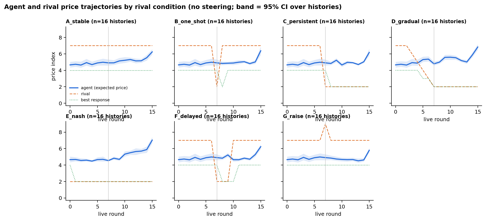

Mean expected price per live round; vertical line = deviation round. Source: `src/research/plots.py:fig_trajectories`, tables trajectories, 112 runs (hash `751214608e34c976`).

### 02_deviation_response

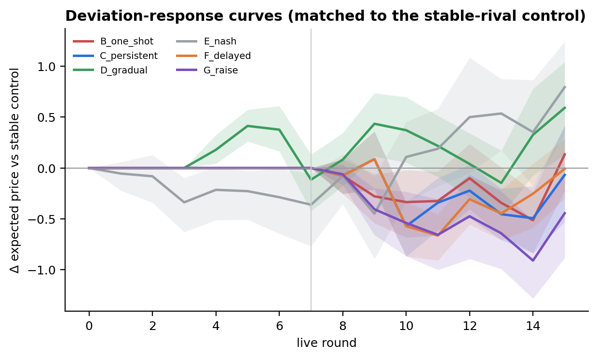

Per-round matched difference with 95% cluster-bootstrap CI. Source: `src/research/plots.py:fig_deviation_response`, tables pair_traj, 96 runs (hash `7e0dbf2f6ead25e2`).

### 02b_fixed_history

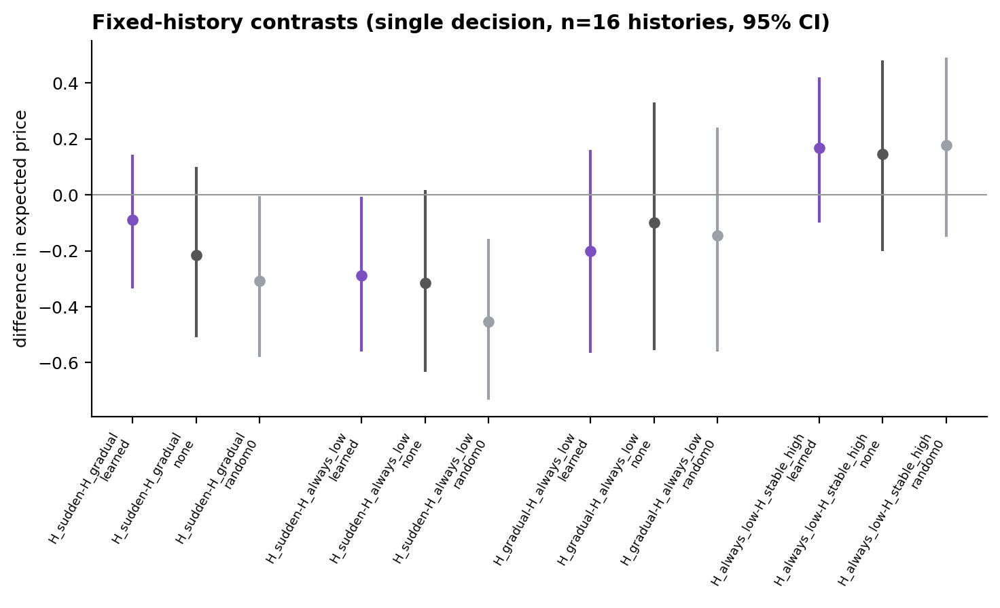

H3: sudden vs gradual at the same final rival price; absolute response: always-low vs always-high. Source: `src/research/plots.py:fig_fixed_history`, tables fixed_history, 48 runs (hash `2598add5c148a627`).

### 03_punishment_recovery

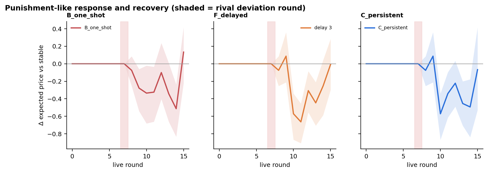

One-shot, delayed-return and persistent deviations. Source: `src/research/plots.py:fig_punish_recover`, tables pair_traj, 48 runs (hash `481e3c08641d31af`).

### 04_steering_trajectories

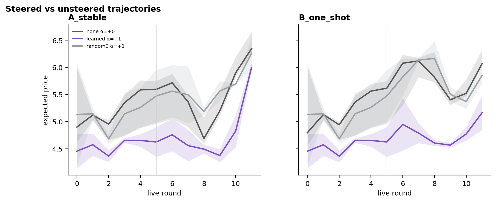

Learned direction vs random control and baseline. Source: `src/research/plots.py:fig_steer_traj`, tables trajectories, 416 runs (hash `1f93c04ccb3cbebc`).

### 05_steering_vs_random

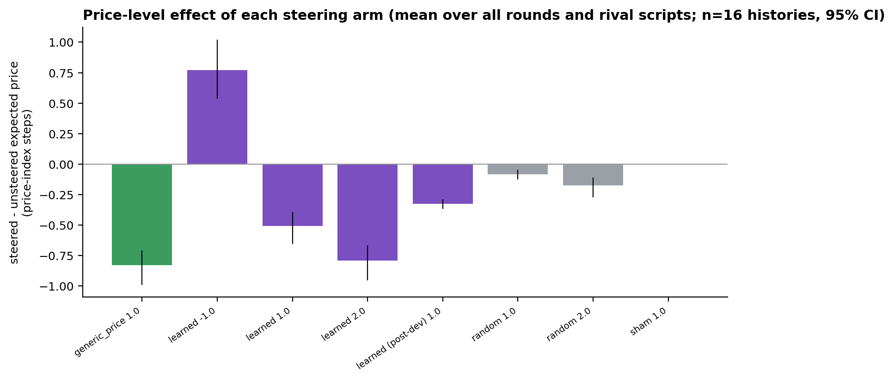

Mean per-round shift with 95% CI. Source: `src/research/plots.py:fig_steer_vs_random`, tables steer_level, 1344 runs (hash `588437a1766e7f04`).

### 06_level_vs_interaction

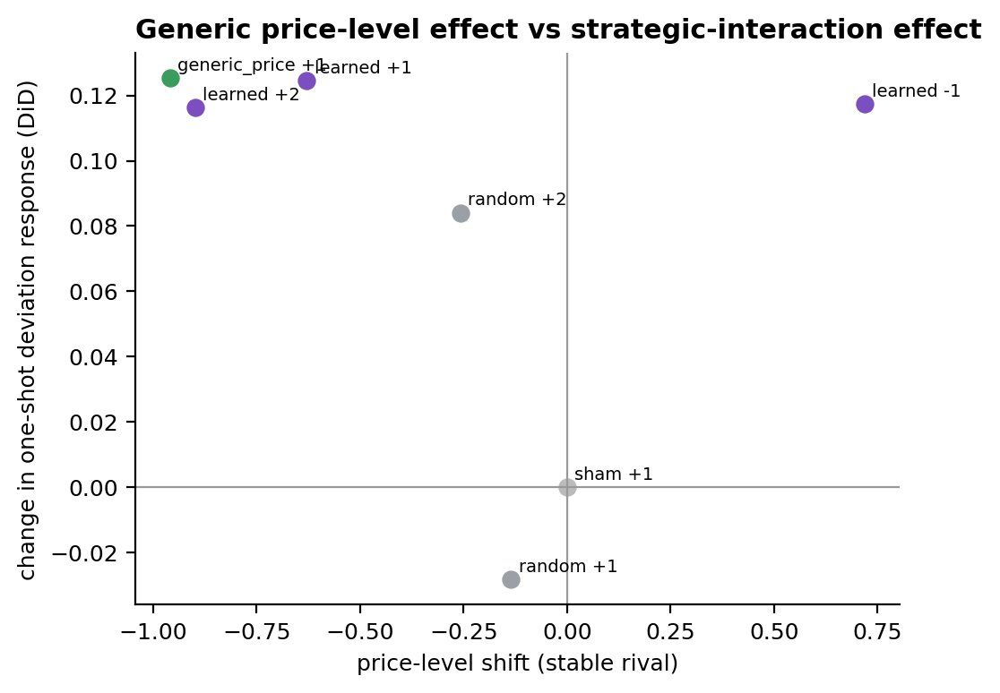

Points on the x-axis only = generic price shift; off-axis = changes deviation responsiveness. Source: `src/research/plots.py:fig_level_vs_interaction`, tables steer_level, did, 1232 runs (hash `7fc01591ecdd8279`).

### 07_seed_distributions

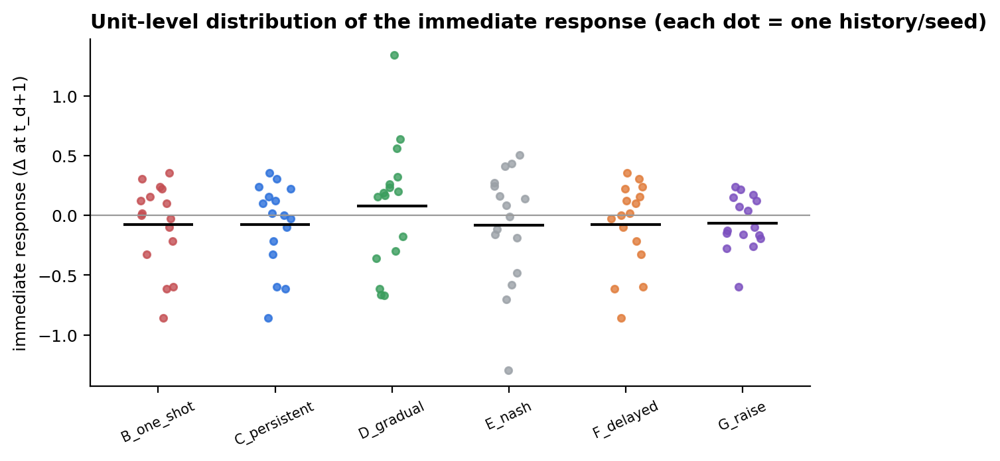

Unit-level spread; bar = mean. Source: `src/research/plots.py:fig_seed_dist`, tables pairs, 96 runs (hash `7e0dbf2f6ead25e2`).

### 15_coverage

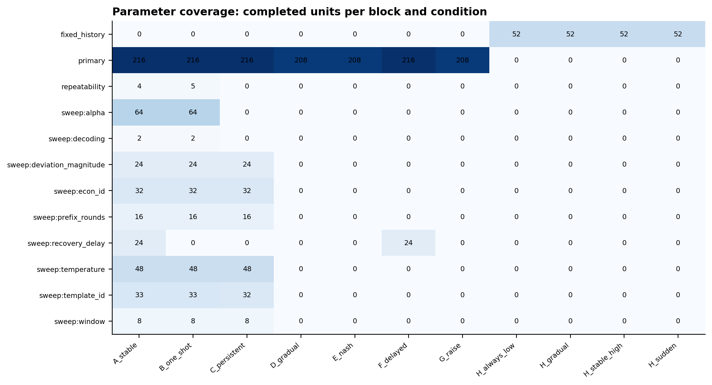

Counts of completed run units. Source: `src/research/plots.py:fig_coverage`, tables units, 2367 runs (hash `e9530f85cd484225`).

### 17_best_response

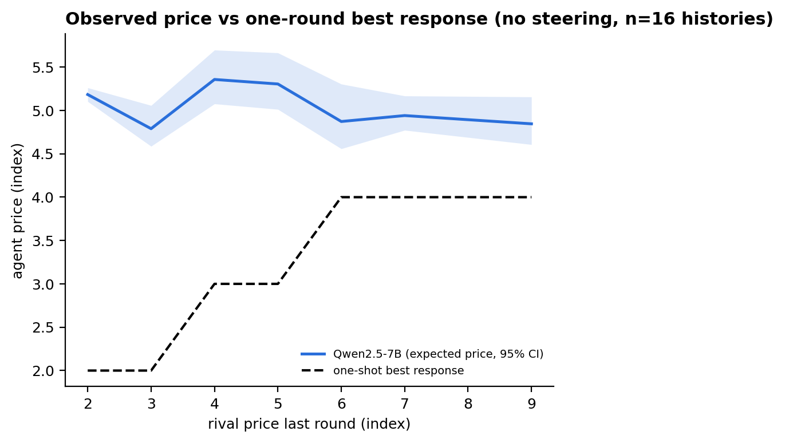

Mean expected price conditional on the rival's previous price. Source: `src/research/plots.py:fig_br`, tables trajectories, 112 runs (hash `751214608e34c976`).

### 18_collusion_index

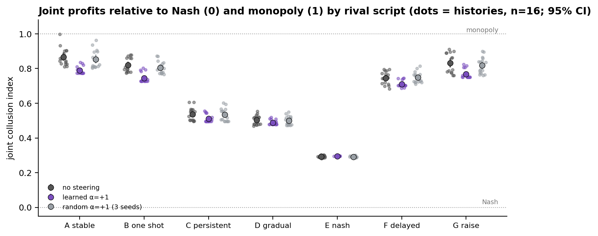

Per-game joint collusion index. Source: `src/research/plots.py:fig_collusion`, tables units, 1456 runs (hash `5ed245b3f1828389`).

### 12_dose_response

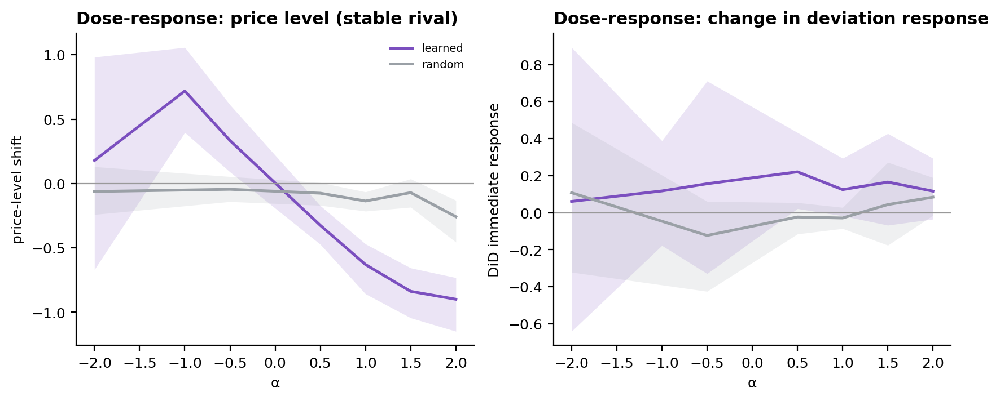

Means with 95% CI across histories. Source: `src/research/plots.py:fig_dose`, tables steer_level, did, 1136 runs (hash `411eee9b10a7ee0f`).

### 21_hypotheses

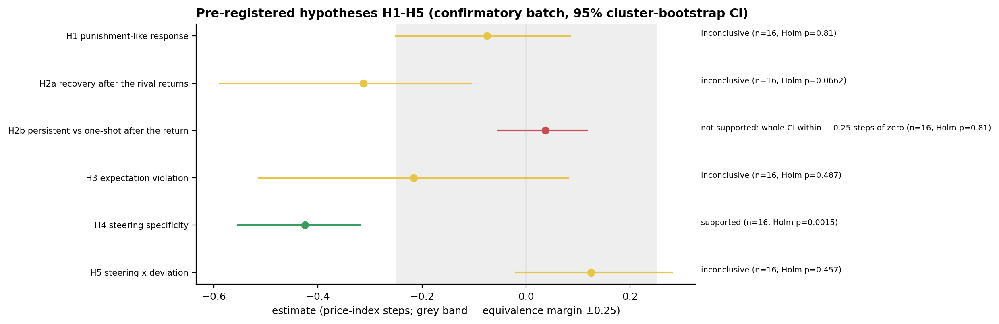

Colour = pre-declared status. Source: `src/research/plots.py:fig_hypotheses`, tables hypotheses, 94 runs (hash `6b45037e0e432225`).

### 22_consistency_dimensions

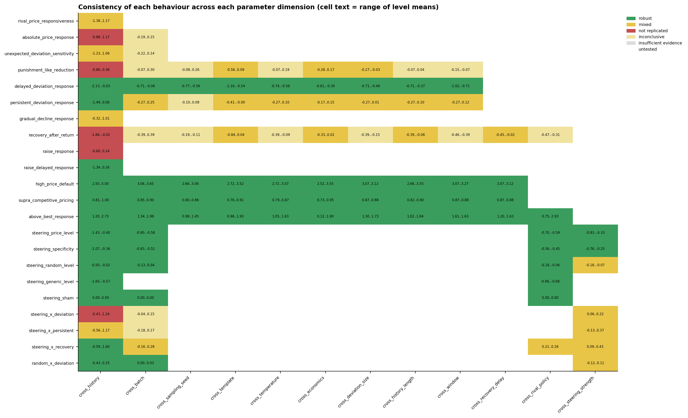

Replication label across the levels of one dimension. Source: `src/research/plots.py:fig_dimensions`, tables consistency_by_dimension, 0 runs (hash `4f53cda18c2baa0c`).

### 08_template_robustness

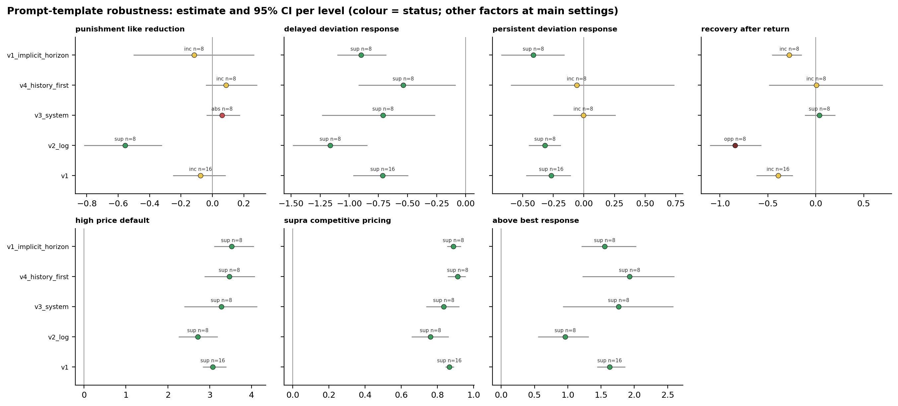

Effect estimate (95% CI) by template_id. Source: `src/research/plots.py:fig_factor`, tables behaviour_cells, 183 runs (hash `960c6adf12046dc9`).

### 09_temperature

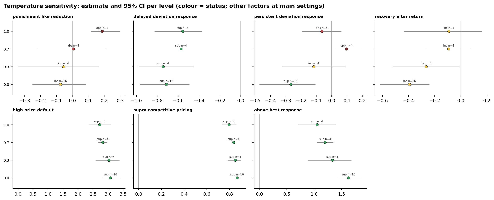

Effect estimate (95% CI) by temperature. Source: `src/research/plots.py:fig_factor`, tables behaviour_cells, 231 runs (hash `f8c47c83be6994eb`).

### 10_history_length

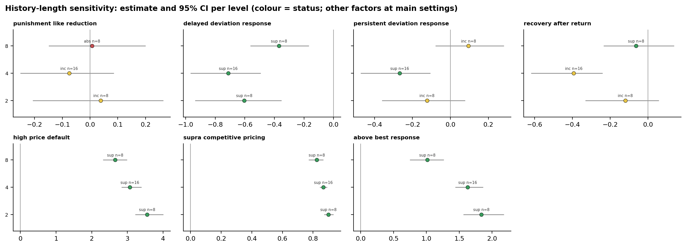

Effect estimate (95% CI) by prefix_rounds. Source: `src/research/plots.py:fig_factor`, tables behaviour_cells, 135 runs (hash `9c85fc36939dcf8d`).

### 11_deviation_magnitude

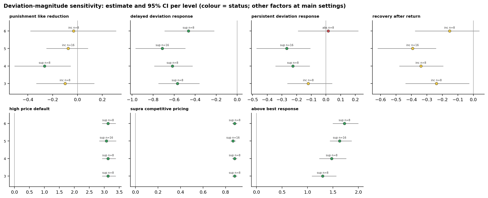

Effect estimate (95% CI) by deviation_magnitude. Source: `src/research/plots.py:fig_factor`, tables behaviour_cells, 159 runs (hash `d7ea6d08e85b4b6a`).

### 11b_economics

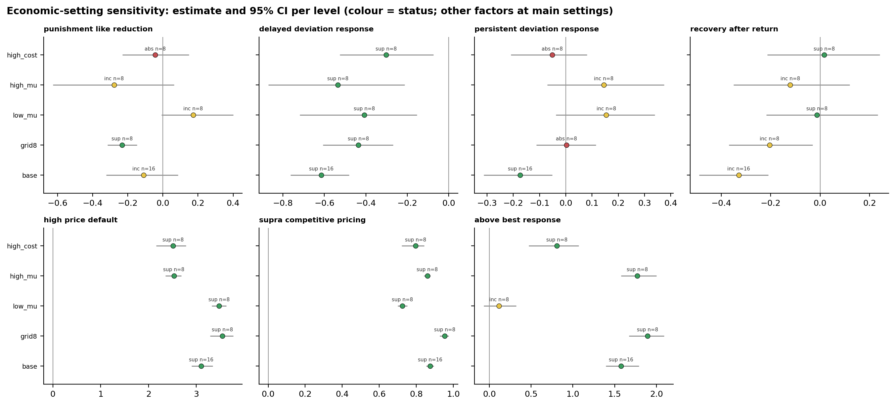

Effect estimate (95% CI) by econ_id. Source: `src/research/plots.py:fig_factor`, tables behaviour_cells, 255 runs (hash `9c71e4a4caf2b28c`).

### 11c_recovery_delay

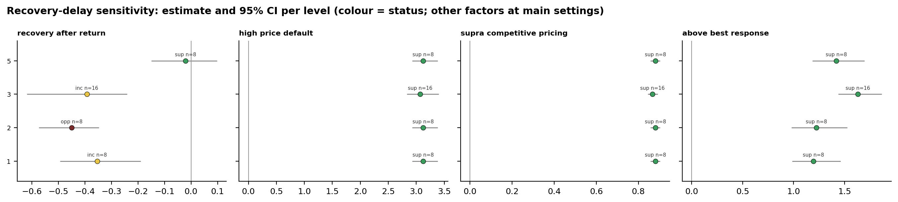

Effect estimate (95% CI) by recovery_delay. Source: `src/research/plots.py:fig_factor`, tables behaviour_cells, 123 runs (hash `42a44fc852ee1742`).

### 11d_steering_strength

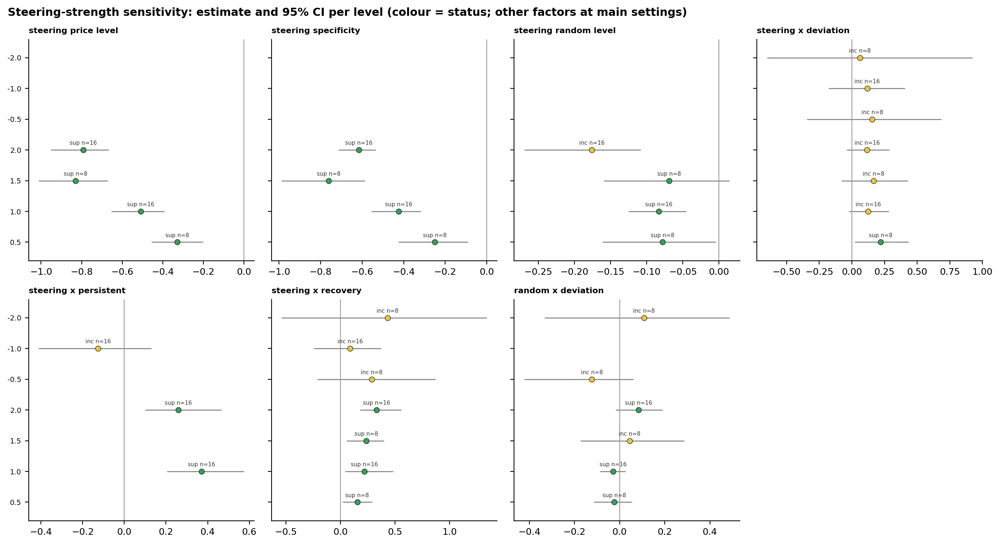

Effect estimate (95% CI) by alpha. Source: `src/research/plots.py:fig_factor`, tables behaviour_cells, 493 runs (hash `b93deca180ec6f76`).

### 11e_sampling_seed

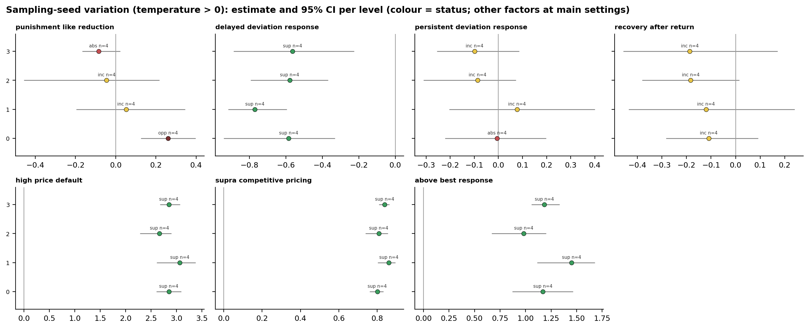

Effect estimate (95% CI) by seed_model_seed. Source: `src/research/plots.py:fig_factor`, tables behaviour_cells, 144 runs (hash `c7aef4fd33569cff`).

### 13_forest

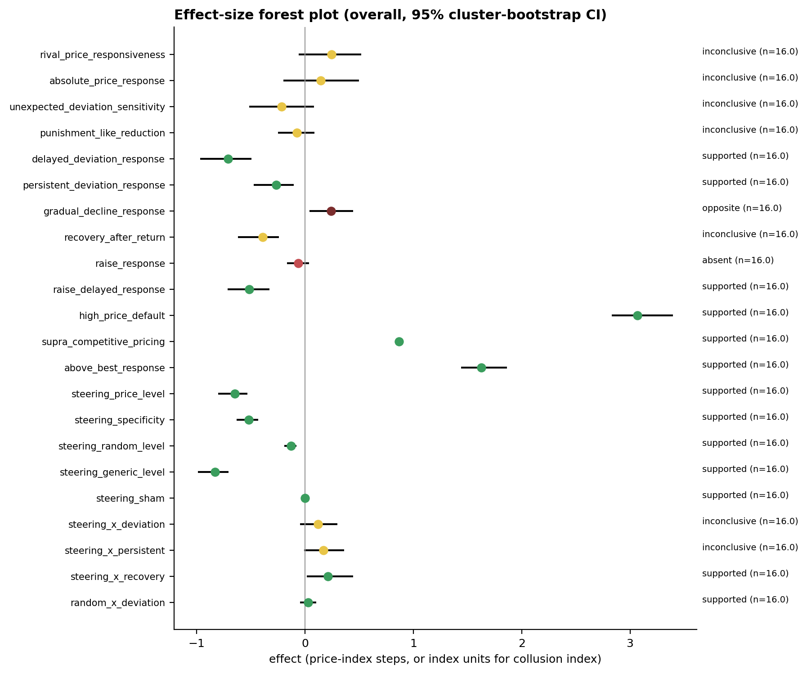

Colour = pre-declared cell status. Source: `src/research/plots.py:fig_forest`, tables behaviour_cells, 512 runs (hash `39e67ca20a95753e`).

### 14_consistency_heatmap

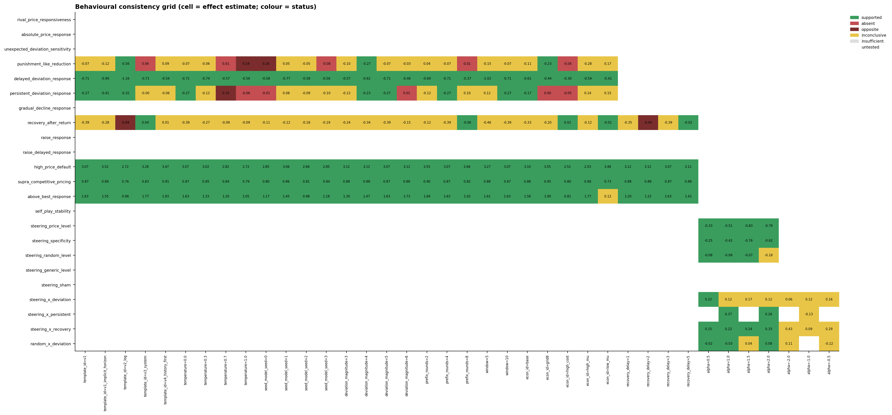

Status per behaviour and tested parameter level. Source: `src/research/plots.py:fig_consistency_heatmap`, tables behaviour_cells, 1108 runs (hash `88e0924506ecc378`).

### 19_negative_results

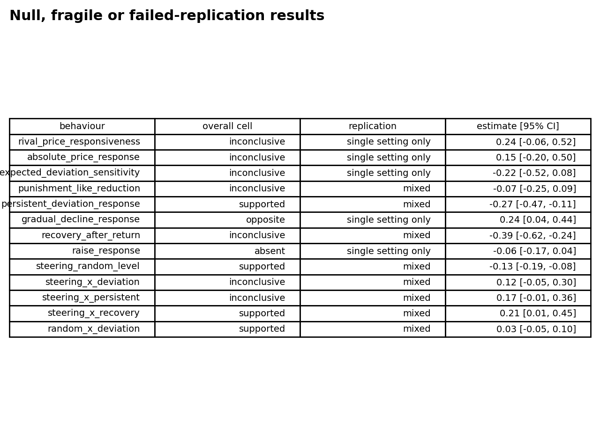

Behaviours whose evidence is absent, inconclusive or mixed. Source: `src/research/plots.py:fig_negative`, tables behaviour_cells, 0 runs (hash `4f53cda18c2baa0c`).

- 16_cross_model: not generated (no variation in model)
### 20_run_dashboard

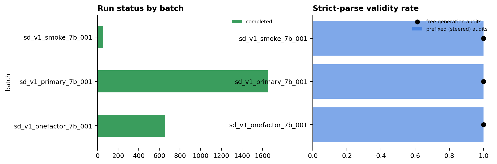

Completion and validity per batch. Source: `src/research/plots.py:fig_dashboard`, tables registry, 2367 runs (hash `e9530f85cd484225`).

## 9. Limitations and interpretation

Evidence ladder used throughout: observed behaviour -> statistical evidence (CI over independent histories) -> causal interpretation (only for matched manipulations and steering contrasts against sham/random/generic controls) -> collusion-related implications (none follow directly from scripted-rival experiments).

- **High prices** and **supra-competitive outcomes** (collusion index > 0) describe outcomes, not mechanisms; a model with a fixed high-price default produces them against any rival.
- **Strategic conditioning** requires a response that depends on the rival's behaviour beyond its current price level (e.g. sudden vs gradual histories ending at the same price, condition H).
- **Punishment-like behaviour** is a matched price reduction after a rival undercut; it is not evidence of intent, and a myopic best-responder also lowers its price after an undercut.
- **Coordination** would require mutual conditioning sustaining prices above competitive levels; scripted rivals cannot establish it. **Intentional collusion** is not testable with these experiments.
- Actions are read from the digit distribution after a forced answer prefix; strict-parse audits of free and prefixed generations are reported per batch and never substituted for missing actions.
- Greedy decoding is deterministic: replication units are distinct histories (history_seed), not model seeds.

## 10. Next experiments

- Resolve: rival_price_responsiveness, absolute_price_response, unexpected_deviation_sensitivity, punishment_like_reduction, recovery_after_return, self_play_stability, steering_x_deviation, steering_x_persistent.
- See research/protocols/robustness_grid_v1.md for the staged plan and cost estimates.

## Legacy evidence (pre-registry, separate protocols)

- `legacy:runs/a1_0.5b.json` (rival_price_edits_phase_a1; model Qwen/Qwen2.5-0.5B-Instruct; revision 7ae557604a): Phase A.1: 24 histories x (control, nonce, cut/raise x stale/realistic); digit scoring + greedy strict parse
- `legacy:runs/a1_1.5b.json` (rival_price_edits_phase_a1; model Qwen/Qwen2.5-1.5B-Instruct; revision 989aa7980e): Phase A.1: 24 histories x (control, nonce, cut/raise x stale/realistic); digit scoring + greedy strict parse
- `legacy:runs/a1_14b.json` (rival_price_edits_phase_a1; model Qwen/Qwen2.5-14B-Instruct; revision cf98f3b3bb): Phase A.1: 24 histories x (control, nonce, cut/raise x stale/realistic); digit scoring + greedy strict parse
- `legacy:runs/a1_32b.json` (rival_price_edits_phase_a1; model Qwen/Qwen2.5-32B-Instruct; revision 5ede1c97bb): Phase A.1: 24 histories x (control, nonce, cut/raise x stale/realistic); digit scoring + greedy strict parse
- `legacy:runs/a1_3b.json` (rival_price_edits_phase_a1; model Qwen/Qwen2.5-3B-Instruct; revision aa8e725379): Phase A.1: 24 histories x (control, nonce, cut/raise x stale/realistic); digit scoring + greedy strict parse
- `legacy:runs/a1_7b.json` (rival_price_edits_phase_a1; model Qwen/Qwen2.5-7B-Instruct; revision a09a35458c): Phase A.1: 24 histories x (control, nonce, cut/raise x stale/realistic); digit scoring + greedy strict parse
- `legacy:runs/b2_0.5b.json` (preregistered_fresh_history_b2; model Qwen/Qwen2.5-0.5B-Instruct; revision 7ae557604a): B2 trend-break test (docs/prereg_deviation_b2.md)
- `legacy:runs/b2_1.5b.json` (preregistered_fresh_history_b2; model Qwen/Qwen2.5-1.5B-Instruct; revision 989aa7980e): B2 trend-break test (docs/prereg_deviation_b2.md)
- `legacy:runs/b2_14b.json` (preregistered_fresh_history_b2; model Qwen/Qwen2.5-14B-Instruct; revision cf98f3b3bb): B2 trend-break test (docs/prereg_deviation_b2.md)
- `legacy:runs/b2_32b.json` (preregistered_fresh_history_b2; model Qwen/Qwen2.5-32B-Instruct; revision 5ede1c97bb): B2 trend-break test (docs/prereg_deviation_b2.md)
- `legacy:runs/b2_3b.json` (preregistered_fresh_history_b2; model Qwen/Qwen2.5-3B-Instruct; revision aa8e725379): B2 trend-break test (docs/prereg_deviation_b2.md)
- `legacy:runs/b2_7b.json` (preregistered_fresh_history_b2; model Qwen/Qwen2.5-7B-Instruct; revision a09a35458c): B2 trend-break test (docs/prereg_deviation_b2.md)
- `legacy:runs/d1_0.5b.json` (repeated_games_d1; model Qwen/Qwen2.5-0.5B-Instruct; revision 7ae557604a): 15-round games vs 8 scripted/reactive rivals, greedy + 4 sampled
- `legacy:runs/d1_1.5b.json` (repeated_games_d1; model Qwen/Qwen2.5-1.5B-Instruct; revision 989aa7980e): 15-round games vs 8 scripted/reactive rivals, greedy + 4 sampled
- `legacy:runs/d1_14b.json` (repeated_games_d1; model Qwen/Qwen2.5-14B-Instruct; revision cf98f3b3bb): 15-round games vs 8 scripted/reactive rivals, greedy + 4 sampled
- `legacy:runs/d1_32b.json` (repeated_games_d1; model Qwen/Qwen2.5-32B-Instruct; revision 5ede1c97bb): 15-round games vs 8 scripted/reactive rivals, greedy + 4 sampled
- `legacy:runs/d1_3b.json` (repeated_games_d1; model Qwen/Qwen2.5-3B-Instruct; revision aa8e725379): 15-round games vs 8 scripted/reactive rivals, greedy + 4 sampled
- `legacy:runs/d1_7b.json` (repeated_games_d1; model Qwen/Qwen2.5-7B-Instruct; revision a09a35458c): 15-round games vs 8 scripted/reactive rivals, greedy + 4 sampled
- `legacy:runs/c3d_7b.json` (steering_transfer_and_steered_games; model Qwen/Qwen2.5-7B-Instruct; revision a09a35458c): C3 transfer vector + steered games (7B)
- `legacy:runs/d1steer_7b_random.json` (steered_games_random_control; model Qwen/Qwen2.5-7B-Instruct; revision a09a35458c): games steered with a norm-matched random vector
- `legacy:phase_c/c1_7b.json` (activation_patching_layers; model Qwen/Qwen2.5-7B-Instruct; revision a09a35458c): patching rival/profit/answer sites by layer
- `legacy:phase_c/c1pos_7b.json` (activation_patching_positions; model Qwen/Qwen2.5-7B-Instruct; revision a09a35458c): single-position patching, layers 16/18/20
- `legacy:phase_c/c2_7b_L10_after_rival.json` (steering_dose_response_mean_difference; model Qwen/Qwen2.5-7B-Instruct; revision a09a35458c): mean-difference steering on A.1 controls
- `legacy:phase_c/c2_7b_L13_answer.json` (steering_dose_response_mean_difference; model Qwen/Qwen2.5-7B-Instruct; revision a09a35458c): mean-difference steering on A.1 controls
- `legacy:phase_c/c2_7b_L16_after_rival.json` (steering_dose_response_mean_difference; model Qwen/Qwen2.5-7B-Instruct; revision a09a35458c): mean-difference steering on A.1 controls
- `legacy:phase_c/c2_7b_L21_answer.json` (steering_dose_response_mean_difference; model Qwen/Qwen2.5-7B-Instruct; revision a09a35458c): mean-difference steering on A.1 controls
- `legacy:phase_c/c2_7b_L21_answer_controls.json` (steering_dose_response_mean_difference; model Qwen/Qwen2.5-7B-Instruct; revision a09a35458c): mean-difference steering on A.1 controls
- `legacy:phase_c/c2_7b_L3_answer_rule.json` (steering_dose_response_mean_difference; model Qwen/Qwen2.5-7B-Instruct; revision a09a35458c): mean-difference steering on A.1 controls
- `legacy:phase_c/c2_7b_L8_rival.json` (steering_dose_response_mean_difference; model Qwen/Qwen2.5-7B-Instruct; revision a09a35458c): mean-difference steering on A.1 controls
- `legacy:phase_b/qwen7b_b1.json` (probing_dataset_b1; model Qwen/Qwen2.5-7B-Instruct; revision a09a35458c): B1 activations (360 prompts) for probes
- `legacy:phase_b2/b2_confirm_7b.json` (preregistered_fresh_history_b2; model Qwen/Qwen2.5-7B-Instruct; revision a09a35458c): B2 (7B, original location)
- `legacy:phase_a_preflight/phase_a_economic_preflight.json` (economic_preflight; model unknown; revision unknown): CPU best-response analysis of Phase A
- `legacy:cpu_0_5b/phase_c_summary_0_5b.json` (cpu_dev_runs_0_5b; model unknown; revision unknown): Qwen2.5-0.5B CPU development runs
- `legacy:cpu_0_5b/phase_c_summary_0_5b_steer.json` (cpu_dev_runs_0_5b; model unknown; revision unknown): Qwen2.5-0.5B CPU development runs
- `legacy:cpu_0_5b/probes.json` (cpu_dev_runs_0_5b; model unknown; revision unknown): Qwen2.5-0.5B CPU development runs
- `legacy:cpu_0_5b/qwen0_5b_a1.json` (cpu_dev_runs_0_5b; model Qwen/Qwen2.5-0.5B-Instruct; revision 7ae557604a): Qwen2.5-0.5B CPU development runs
- `legacy:cpu_0_5b/qwen0_5b_b1.json` (cpu_dev_runs_0_5b; model Qwen/Qwen2.5-0.5B-Instruct; revision 7ae557604a): Qwen2.5-0.5B CPU development runs
- `legacy:cpu_0_5b/qwen0_5b_c1.json` (cpu_dev_runs_0_5b; model Qwen/Qwen2.5-0.5B-Instruct; revision 7ae557604a): Qwen2.5-0.5B CPU development runs
- `legacy:cpu_0_5b/qwen0_5b_c2.json` (cpu_dev_runs_0_5b; model Qwen/Qwen2.5-0.5B-Instruct; revision 7ae557604a): Qwen2.5-0.5B CPU development runs